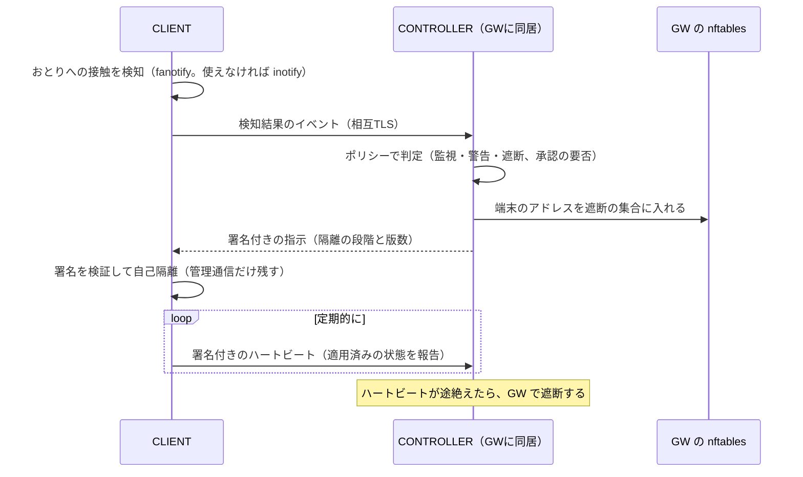
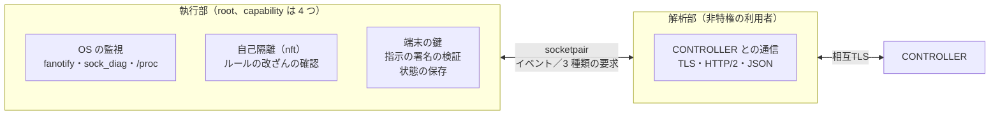
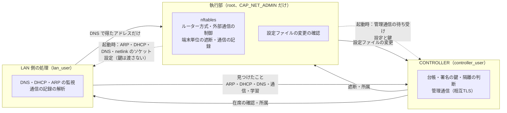
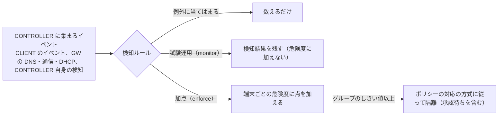
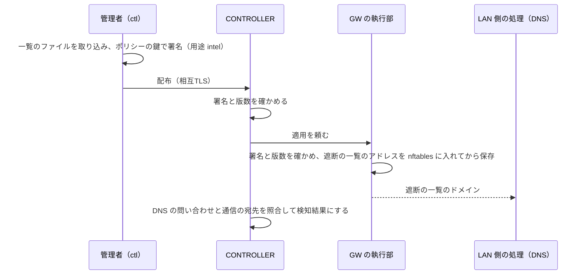
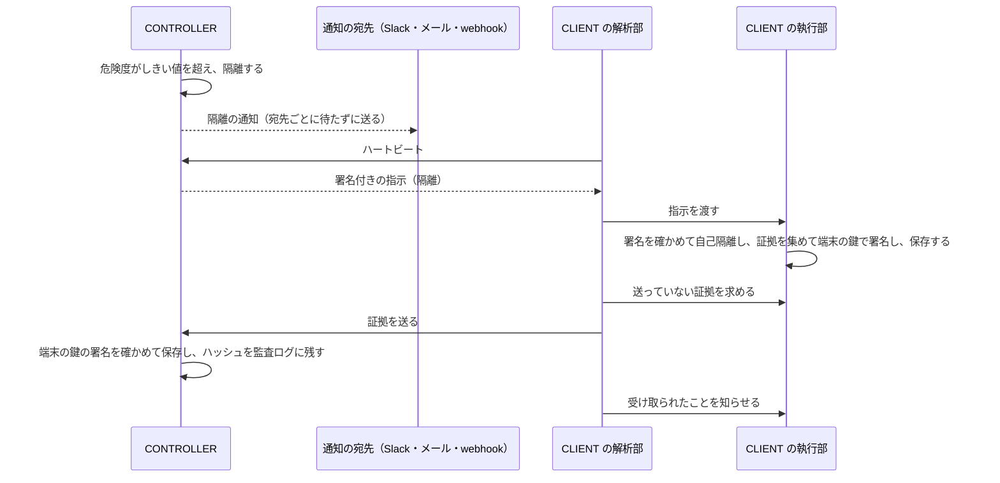
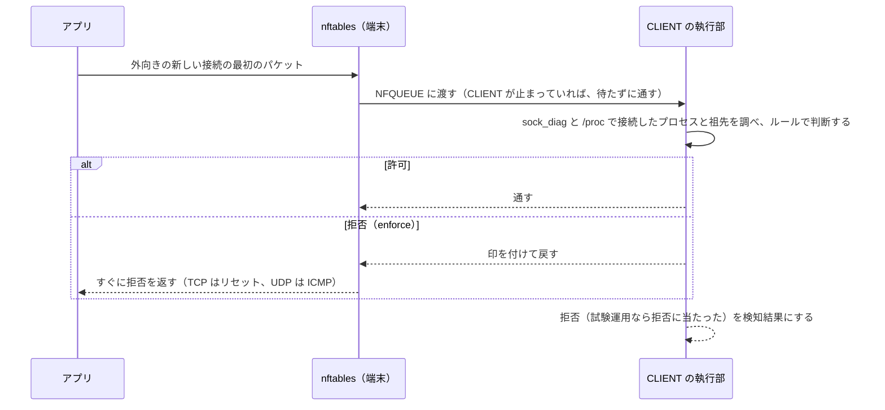

# 開発方針

機能要件（[requirements.md](requirements.md)）を実装するための方針を記録する。2026-10-18に合意した内容で、方針を変えたときはこの文書を更新する。

## 決定事項

| 項目 | 決定 | 補足 |
|---|---|---|
| 進め方 | フェーズ1を段階（1a〜1f。大きい段階はさらに分ける）に分け、1bで検知から隔離までを先につなぐ | 下の「フェーズ1の進め方」 |
| フェーズ2の進め方 | 個々の検知を足す前に、検知を調整する土台（検知ルールの配布、誤検知の例外、試験運用、危険度による判断）を作る（2a） | 下の「フェーズ2の進め方」。リリースの前に動作の検証と調整をまとめて行う |
| GWの既定の接続形態 | ルーター（NAT） | DHCP（G8）と自然に両立する。ブリッジは後で追加する |
| 実行ファイル | 1つにまとめ、`susanoo gw`、`susanoo client`、`susanoo controller`、`susanoo ctl` のようにモードを指定して起動する | パッケージを分けておき、必要になればビルドタグでモードごとに分割する |
| 依存 | 当面は標準ライブラリのみ | golang.org/x/ はこの開発機になく、ダウンロードもしない（「開発環境と検証の規則」）。必要になった時点で入手方法を決める |
| 対象規模 | 1拠点・1ネットワーク・250台まで | 家庭向けと事業所向けはソフトを分けず、ポリシーの初期値で分ける |
| 文書 | Markdownを正本とする | docxは差分を追えないため。原本のdocxは、本文と図がすべてMarkdownに移っていることを確かめて削除した |
| ライセンス | Apache-2.0 | 2026-10-19 に決定 |
| プロジェクト名 | susanoo | 2026-10-19 に決定 |

## ディレクトリ構成

既存のディレクトリ構成を守る。ソースはすべて `src/` の下に置き、`src/` を Go のモジュール `susanoo` の起点とする。パッケージは `susanoo/internal/api` のように、モジュール名とディレクトリのパスで参照する。モジュール名と import に `github.com` などの外部のホスト名は使わない。

検証環境の試験（`test/lab`）は `susanoo` の実行ファイルだけを外から操作するため、別のモジュール `susanoo/test` とする。go コマンドはそれぞれのモジュールのディレクトリで実行する（Makefile は `go -C src`、`go -C test` を使う）。

```
bin/                 ビルドした実行ファイル（Gitでは管理しない。make dist は bin/dist に配布するファイルを作る）
config/              設定とポリシーの例
deploy/systemd/      systemd のユニットと、GW の利用者の定義（sysusers）
docs/                文書（要件、開発方針、導入の手順）
src/                 Goのソース（モジュール susanoo）
  go.mod
  cmd/susanoo/       実行ファイルの入口（モードの振り分け）
  internal/          各機能のパッケージ
test/                検証環境の試験（モジュール susanoo/test）
  go.mod
  lab/               ネットワーク名前空間で動かす結合試験（make lab-test）
Makefile             ビルドと試験の入口
SECURITY.md          脆弱性の報告の窓口
VERSION              版数
```

## フェーズ1の進め方

フェーズ1（MVP）は約22の機能を含むため、機能ごとに作り込む前に、各機能を最小限ずつ作って端から端までつなぐ。これにより、フェーズ1のゲート（検証環境で、検知から隔離までが自動で動く）の中心部分を早く確かめる。

| 段階 | 内容 |
|---|---|
| 1a 共通基盤 | 実行ファイルの骨格、内部の認証局と相互TLS、署名（ed25519）、イベント形式、ポリシー形式、監査ログ、Platformインターフェース |
| 1b 最小構成をつなぐ | おとり（C5）に触れる → CONTROLLERへ通知（M4）→ 自動隔離（M6）→ GWの遮断（G9）とCLIENTの自己隔離（C6）。ハートビートの途絶（G10）でも隔離する |
| 1c-1 GWの拡充（ネットワークと台帳） | G1（ルーター方式）、G8（DHCP、ARP の監視、機器の台帳）、G12 の一部（GW 自身の保護、設定の改ざん検知） |
| 1c-2 GWの拡充（通信の制御） | G3、G2（学習モードと原則拒否）、G4、G12 の残り（障害時の動作） |
| 1c-3 GWの拡充（通信の記録） | G5（フローの記録、TLS の SNI と指紋、平文の HTTP の Host） |
| 1d-1 CLIENTの拡充（監視） | C1、C2、C3（大量の変更の検知を含む）、C12、C10 の一部（自己隔離のルールの改ざんへの対応） |
| 1d-2 CLIENTの拡充（自己防御） | C10 の残り（特権の執行部と非特権の解析部の分離）、C5 の残り（fanotify でのおとりの削除の検知） |
| 1e-1 GWの権限の分離（執行部） | G12 の残り（権限分離）の前半：GW を、nft とソケットの用意を受け持つ特権の執行部と、非特権の部分に分ける |
| 1e-2 GWの権限の分離（CONTROLLERとLAN側の処理） | G12 の残りの後半：非特権の部分を、CONTROLLER（台帳、署名の鍵、隔離の判断）と、LAN 側の処理（DNS、DHCP、ARP、通信の記録）に分け、別々の利用者で動かす |
| 1f-1 管理機能の拡充（証明書） | M1 の残り（証明書の更新と失効） |
| 1f-2 管理機能の拡充（ポリシー） | M2（署名付きの配布、版の管理とロールバック、段階的な適用） |
| 1f-3 管理機能の拡充（CLI） | M8（全体の状態の表示、イベントの検索） |

最初の検知におとり（C5）を選ぶのは、誤検知がほとんどなく実装が小さいため、構成と経路の検証に集中できるからである。

## フェーズ2の進め方

フェーズ2（v1）のゲートは「学習モードで誤検知が許容範囲に収まる」である。振る舞いの検知（G6、C8 など）は誤検知が出やすいため、先に、検知を調整できる土台（2a）を作り、その上に個々の検知を足す。各段階の実装を先に進め、リリースの前に動作の検証と調整をまとめて行う。

| 段階 | 内容 |
|---|---|
| 2a 検知の基盤 | M3（検知ルールの署名付きの配布、版の管理、誤検知の例外、ルールごとの試験運用と段階配布）、M5（端末ごとの危険度としきい値による自動対応） |
| 2b-1 GW の検知（振る舞い） | G6（周期的な通信、大量の送信、LAN 内のスキャン、新しい宛先の急増、時間外の通信） |
| 2b-2 GW の検知（脅威情報） | G7（悪性のドメインとアドレスの一覧の取り込み、照合、遮断） |
| 2c-1 CLIENT の検知（観測） | C4（永続化と権限の監視、権限昇格、カーネルモジュール）、C8 の認証情報へのアクセス、C9（AI エージェントの帰属、鍵の置き場所の監視）。CLIENT が観測を広げ、検知結果を出す |
| 2c-2 CLIENT の検知（ルール） | C8（正規ツールの不審な使い方、不審な親子関係、連続する列挙）、C9（エージェントの操作）を CONTROLLER の既定の条件のルールで検知する |
| 2d-1 対応（通知と証拠） | M7（通知。試験はローカルの偽のサーバーだけで行う）、C11（証拠の保全） |
| 2d-2 運用 | M9（インシデント対応の支援）、M11（設定のバックアップ） |
| 2e 制御の強化 | C7（プロセス単位の通信制御） |
| 2f 学習モードの期間 | G2 の残り（学習モードの期間と、原則拒否へ移る手順。未決事項の「学習モードの期間」を決めた） |
| 2g-1 二段構えの鍵 | M1 の残り（オフラインのルートの認証局と、GW の発行用の認証局。要件への追加を検討する事項の 4） |
| 2g-2 初回登録 | M1 の残り（一回限りの登録コードによる端末の登録。要件への追加を検討する事項の 5） |
| 2h ログオンの記録 | C4 の残り（ログオンとログオフ、失敗したログオンの記録） |
| 2i-1 IPv6 の LAN の監視 | G8 の ND の監視（機器の IPv6 アドレス、IPv6 のなりすまし、不正なルーター広告、不正な DHCPv6 サーバー） |
| 2i-2 IPv6 の転送 | G1 の IPv6（LAN の IPv6 の転送と、外部通信の制御などの IPv6 対応） |
| 2j ブリッジ方式 | G1 のブリッジ方式 |
| 2k 署名付きリリース | 共通基盤の署名と非機能の更新（オフラインの鍵で署名したリリースを、先行適用から段階的に CLIENT に配って入れ替える） |
| 2l CLIENT の資源と時刻 | 非機能の性能（CLIENT の CPU とメモリの上限と、超えたときの扱い）、共通基盤の時刻（端末の時刻のずれと、時刻の同期の状態） |
| 2m-1 v1 の残り（端末の監視） | 1f-3 の制限の解消：適用済みの版数が遅れ続ける端末の検知（乗っ取られた解析部）、CLIENT による GW の MAC アドレスの変化の監視、隔離中の更新サーバーの変更の CLIENT への反映、守る場所の外での大量の変更の検知 |
| 2m-2 v1 の残り（GW の検知） | 1f-3 の制限の解消：許可していない SNI の検知、アドレスを直接指定した通信の学習の記録、DNS で得たアドレスの許可への異常な追加の拒否と、LAN 側の処理の知らせの食い違いの検知 |
| 2m-3 v1 の残り（管理） | 1f-3 の制限の解消：管理者の証明書の失効、認証局の証明書の更新、イベントの検索の索引 |
| 2n 手元でできる品質保証 | SBOM、脆弱性の報告の窓口（SECURITY.md）、導入の手順と systemd のユニット |

2g 以降は、検証環境の試験（`make lab-test`）で確かめられる機能のうち、残っているものを先に仕上げる段階である。2k と 2l は、非機能と共通基盤の項目のうち検証環境で確かめられるもの、2m は、以前の段階の制限の表で v1 に対応するとしたもの、2n は手元で確かめられる品質保証である。M8 の画面（フェーズ3）と、実機での性能の測定は含めない。

## 共通基盤の設計

1aで実装した共通基盤の要点。詳細は `src/internal/` の各パッケージの説明を参照。

| パッケージ | 内容 |
|---|---|
| keys | 鍵はすべて ed25519 に統一する。秘密鍵は所有者だけが読める権限（0600）で保存し、ほかの人も読める権限のファイルは読み込みを拒否する |
| pki | 内部の認証局。証明書には `susanoo://<役割>/<ID>` の形のURIを入れ、接続相手をこのURIで識別する。役割は controller、gw、client、admin。サーバーになる役割の証明書には `<役割>.susanoo.internal` の名前も入れる。有効期間は認証局が10年、それ以外が90日（残りが 3 分の 1 を切ったら同じ鍵で更新する。1f-1）。秘密鍵は持ち主の機器から出さず、認証局は公開鍵だけを受け取って発行する |
| transport | 管理通信の相互TLS。TLS 1.3 だけを使い、証明書の検証に加えて、相手の役割が許可したものかを確かめる |
| sign | 用途（policy、rules、command、heartbeat）と中身のバイト列に ed25519 で署名する。JSON を正規化せず、署名したバイト列をそのまま運び、検証に通ってから解析する |
| policy | ポリシーは JSON。知らない項目は書き間違いとみなして拒否する。版数は配布のたびに増やし、今の版数以下のポリシーは適用しない。グループ名に「~」は使えない（先行適用の印）。配布の仕組みは 1f-2。例は [config/policy.example.json](../config/policy.example.json) |
| event | イベントは OCSF 1.3 に準拠する。使うクラスは 1001（ファイル）、1007（プロセス）、2004（検知結果）、4001（通信）、4003（DNS）、4004（DHCP） |
| audit | 監査ログは JSON Lines で、各記録に直前の記録のハッシュ（SHA-256）を含める。途中の書き換え、削除、挿入は検知できる。末尾をまとめて消されることへの備えとして、末尾の状態（Head）を別の場所にも保管する |
| platform | Platform インターフェース（対応機能の申告、イベントの取得、自己隔離、解除）。試験用の偽物の実装を `platformtest` に置く |
| privsep | 権限の分離（CLIENT は 1d-2、GW は 1e-1 と 1e-2）。プロセスどうしのやり取り（長さつきの JSON のフレームで、要求、応答、知らせ）、非特権のプロセスの起動とソケットの受け継ぎ、capability の絞り込み |

## 検知から隔離までの流れ（1b）

1bで、おとりへの接触とハートビートの途絶から隔離までをつないだ。CONTROLLER は GW に同居させ、`susanoo gw` で起動する。



- 指示は「端末に期待する状態」で、版数を付ける。CLIENT は適用済みの版数より新しい指示だけを適用し、途中の指示が失われても次の応答で収束する。版数は時刻（ナノ秒）以上の値にするので、CONTROLLER の台帳が失われても版数が戻らない。
- 指示には端末 ID を含め、CONTROLLER の鍵で署名する。CLIENT は署名、用途、宛先を検証してから適用する。
- CLIENT は適用した指示を記録し、再起動しても、CONTROLLER に接続できなくても隔離を続ける。
- 自己隔離では、段階にかかわらず CONTROLLER への管理通信を残す（解除の指示を受け取るため）。全遮断は GW の役割とする。
- GW の遮断のルールはカーネルに残るので、susanoo が止まっても遮断は続く。起動時には台帳から遮断を復元する。
- 端末側の遮断が消されても、GW で止まり続ける（検証環境の試験で確認する）。
- 端末の登録は、端末で `susanoo client keygen`、CONTROLLER で `susanoo ctl issue` を行う。秘密鍵は端末から出さない。2g-2 で、一回限りの登録コードで登録する手順（`ctl enroll create`、`client enroll`）を足した。
- 管理操作は `susanoo ctl devices`、`ctl isolate`、`ctl release`。監査ログの連鎖は `ctl audit` で確かめる。

## ルーター方式の GW と LAN の機器の台帳（1c-1）

1c-1 で、GW をルーター方式で動かし、LAN の機器を台帳で管理するようにした。

- ルーター方式（G1）：LAN から WAN への通信を NAT で送り出し、その戻りの通信だけを通す。LAN の IPv6 の転送は遮断する（「要件への追加を検討する事項」の 6）。GW 自身は、LAN からの DHCP、管理通信、管理用のポート（既定は SSH の 22）、ping だけを受け付ける（G12）。2i-1 で、IPv6 の ping も受け付け、GW の LAN 側では LAN の機器のルーター広告に従わない（accept_ra を 0 にする）ようにした。2i-2 で、`router.ipv6` を有効にすると LAN の IPv6 を転送するようにした。
- DHCP サーバー（G8）：同じ機器にはできるだけ同じアドレスを渡し続ける。隔離中の機器のアドレスは、期限が切れてもほかの機器に渡さない。
- LAN の機器の台帳（G8）：DHCP と ARP で見えた機器を MAC アドレスで記録し、初めて見た機器を検知結果にする。CLIENT のない機器も載る（「要件への追加を検討する事項」の 2）。端末とは、ハートビートの送信元のアドレスで結び付ける。一覧は `susanoo ctl hosts`。
- なりすましの検知（G8）：GW のアドレスを名乗る ARP（ゲートウェイのなりすまし）と、ほかの機器に割り当て中のアドレスを名乗る ARP（アドレスのなりすまし）を検知し、名乗った機器を隔離する。端末に結び付いた機器なら端末を隔離する。
- GW の遮断（G9）：アドレスと MAC アドレスの両方で遮断する。隔離した端末がアドレスを変えても止まる。CLIENT のない機器は GW の遮断だけで隔離する。`ctl isolate` と `ctl release` は MAC アドレスでも指定できる。
- 在席の確認（G10、「要件への追加を検討する事項」の 3）：ハートビートが途絶えたら、GW が ARP でその端末が LAN にいるかを確かめる。いれば隔離し、いなければ「不在」として隔離しない。不在の端末が LAN に戻ったら確認を再開し、接続し直す時間を見込んで判定までの時間を 2 倍にする。
- 接続の立て直し：CLIENT は、アドレスが変わったときなどに応答しなくなった接続を使い続けない。要求が失敗したら接続し直し、古い接続は HTTP/2 の PING の時間切れで閉じる。在席の確認では、端末に結び付いた機器の新しいアドレスにも問い合わせる。
- 設定の改ざん検知（G12）：GW の設定ファイルとポリシーの変更を 30 秒ごとに確かめ、変わったら監査ログと検知結果に残す（設定の反映は再起動したとき。ポリシーは 1f-2 から `ctl policy push` で配布し、設定のポリシーのファイルは最初の版としてだけ使う）。

GW の設定の例は [config/gw.example.json](../config/gw.example.json)（ブリッジ方式は [config/gw-bridge.example.json](../config/gw-bridge.example.json)。2j）。

## DNS と外部通信の制御（1c-2）

1c-2 で、GW の DNS リゾルバと、グループごとの外部通信の制御を加えた。GW の設定に `dns` を書くと有効になる（例は [config/gw.example.json](../config/gw.example.json)）。

- DNS リゾルバ（G3）：LAN 側のアドレスの 53 番で受け、上流に転送する。上流は複数書け、順に問い合わせる。`tls_name` を書いた上流には DNS over TLS で問い合わせる（例：`{"address": "203.0.113.53:853", "tls_name": "dns.example.jp"}`）。上流への問い合わせの ID はランダムに付け替え、問い合わせと一致しない応答は捨てる。DHCP では、端末に GW のリゾルバを知らせる。キャッシュは持たない。
- 外部の DNS への直接の問い合わせ（G3）：LAN から外部の DNS サーバーの 53 番への問い合わせは、GW のリゾルバに向け直す（端末には気づかれずに、ポリシーが効く）。
- 問い合わせの記録（G3）：すべての問い合わせを OCSF の DNS Activity（4003）として保存する（`log_queries: false` で止められる）。
- 外部通信の制御（G2）：グループごとに、拒否リスト、許可リスト、既定の扱いを適用する。既定の扱いが `deny`（許可リスト）のグループでは、許可したドメインを DNS で解決したときに、そのアドレスを TTL に余裕を足した期間だけ許可に加える（応答を返す前に加えるので、端末はすぐに接続できる）。許可していない名前は引けない（DNS を使った持ち出しも防ぐ）。`learn`（学習モード）のグループでは、通した名前を記録する。遮断した名前もグループごとに記録し、`susanoo ctl learned` で一覧できる（許可リストを作るときに使う）。
- グループの割り当て：`susanoo ctl group <端末 ID か MAC アドレス> <グループ>`。端末に結び付いた機器は端末のグループになる。GW はグループの所属を MAC アドレスで判断する。
- 抜け道の遮断（G4）：グループごとに、QUIC（UDP 443）、DNS over TLS（853）と既知の公開 DNS サーバーへの 443、VPN とトンネル（IPsec、OpenVPN、WireGuard、L2TP、PPTP、ESP、AH、GRE）を遮断する。DoH の接続先の名前と、iCloud プライベートリレーの名前は引けなくする（引けなければ、ブラウザーや OS はこれらを自動では使わない）。ポリシーの `bypass` で、グループごとに例外を作れる。
- ECH への対策（「要件への追加を検討する事項」の 1）：DNS の HTTPS・SVCB レコードの問い合わせには「該当なし」を返し、ECH の設定を端末に渡さない（`bypass.allow_ech` で例外にできる）。DoH を遮断しているので、ほかの経路からも得られない。
- 隔離中の更新サーバー：更新サーバーも許可する段階の端末には GW の DNS を許可し、ドメインで指定した更新サーバーの名前だけを引かせ、そのアドレスへの通信を許可する（1c-1 の制限の解消）。
- 障害時の動作（G12）：ポリシーの `on_failure` が `fail_open` なら、GW を止めるときに外部通信の制御をやめ、LAN の DNS を最初の平文の上流に向け直す。`fail_closed` なら制御を残す。端末単位の隔離は、どちらでも残す。異常終了の場合は制御がそのまま残る（systemd の `Restart=always` などで再起動する前提）。

## 通信の記録（1c-3）

1c-3 で、GW が LAN から外への通信を記録するようにした（G5）。ルーター方式では既定で有効で、GW の設定の `"flow_log": false` で止められる。どちらの仕組みも転送の経路の外で動くので、回線の速度を落とさない。

- フローの記録：conntrack の接続の終わりのイベントを netlink で受け取り、送信元、宛先、プロトコル、通信量（両方向のバイト数とパケット数）、開始と終了の時刻を、OCSF の Network Activity（4001、Close）として保存する。GW は起動時に `nf_conntrack_acct` と `nf_conntrack_timestamp` を有効にする。TCP の接続の記録は、接続が閉じてから conntrack が接続を消すまで（TIME_WAIT の既定は 120 秒）遅れて届く。期限の切れた接続を消すのはカーネルの周期的な片付け（間隔は最大 60 秒）なので、さらにその分遅れることがある。検証環境の試験では、GW の conntrack の表を消して終わりのイベントをすぐに出させている。
- TLS の SNI と指紋：nftables（`susanoo_flow` のテーブル）が、LAN から 80 番と 443 番への各接続の最初の 10 パケットだけを NFLOG で渡す。ClientHello を順序どおりに組み立てて（耐量子の鍵交換で 1 パケットに収まらない場合も含む）、SNI、ALPN、TLS の版、JA4 の指紋を取り出し、Network Activity（Open）として保存する。接続の終わりの記録にも付ける。JA4 は OCSF 1.3 に項目がないため `unmapped.tls.ja4` に入れる。このテーブルは遮断より先に評価するので、遮断した接続の SNI も記録できる。
- 平文の HTTP の Host：同じく最初のパケットから、要求のメソッドと Host を取り出す。
- 記録するのは LAN から外へ転送する通信だけで、GW 自身の通信と、GW のリゾルバに向け直した DNS は記録しない。記録は端末 ID と結び付ける。

## CLIENT の監視（1d-1）

1d-1 で、CLIENT が端末の中の動きを記録するようにした。設定の例は [config/client.example.json](../config/client.example.json)。

- プロセスの監視（C1）：実ファイルを持つファイルシステムごとに fanotify の「実行ファイルを開いた」イベント（FAN_OPEN_EXEC）を受け取り、プロセスの起動を、コマンドライン、親プロセス、利用者、実行ファイルのパスと SHA-256 とともに OCSF の Process Activity（Launch）として記録する。ハッシュは、イベントで渡された実際に実行されたファイルから計算する（すり替えに強い）。ハッシュは、ファイルが変わらない限り計算し直さない。動的リンクのプログラムでは、カーネルが本体に続けて動的リンカー（ld-linux など。ET_DYN で PT_INTERP を持たない形）も実行のために開くので、同じプロセスの実行のイベントの直後（1 秒以内）に届いた動的リンカーのイベントは、別の起動として記録しない（動的リンカーを直接動かした場合は記録する）。起動を記録したプロセスの終了は `/proc` で確かめて記録する（Terminate）。当初の案の proc connector は最初のネットワーク名前空間でしか使えず、コンテナや検証環境で動かないため、この方式にした。CLIENT はホスト全体のプロセスを記録する。
- 通信とプロセスの結び付け（C2）：sock_diag で TCP と、相手を決めた UDP のソケットの一覧を 2 秒ごとに取り、新しい接続を `/proc/*/fd` でプロセスに結び付けて、OCSF の Network Activity（Open）として記録する。待ち受けているポートへの接続は内向き、それ以外は外向きとする。同じプロセスから同じ相手への接続は 60 秒に 1 件にまとめる。GW からは見えない「どのプロセスが接続したか」が分かる。
- 重要な場所の監視（C3）：fanotify の FID 方式で、認証情報、権限、自動起動、シェルの起動設定などの変更（作成、変更、削除、名前の変更、属性の変更）を、変更したプロセスとともに OCSF の File System Activity として記録する。既定の場所は `/etc/passwd`、`/etc/sudoers.d`、cron、systemd、各利用者の `.ssh` や `.bashrc` など（2c-1 で、永続化と権限に関わる場所は検知結果も出すようにした）。
- 大量の変更の検知（C3、T7 ランサムウェア）：守る場所（既定は各利用者の「ドキュメント」「デスクトップ」「ピクチャ」。日本語の名前も含む）の下のディレクトリを起動時に洗い出し、1 つのプロセスが 30 秒以内に 200 個以上のファイルを変更したら検知結果にする。CONTROLLER はポリシーに従って端末を隔離する。
- 対応機能の申告（C12）：使えた監視だけを機能（process_events、network_events、file_events）として申告する。
- 自己隔離のルールの改ざんへの対応（C10 の一部）：隔離中は、ハートビートのたびに自己隔離のルールが残っているかを確かめ、消されていたら入れ直して、改ざんの検知結果を送る。
- イベントの量：プロセス、通信、ファイルのイベントには、1 秒あたりの上限を設ける（上回った分は数だけをログに残す）。カーネルの fanotify の待ち行列があふれてイベントを取りこぼしたときも、黙って捨てずに、1 分に 1 回まで回数を警告のログに残す（大量の操作で監視を取りこぼさせる攻撃もあるため）。

## CLIENT の権限の分離と自己防御（1d-2）

1d-2 で、CLIENT を特権の執行部と非特権の解析部に分けた（C10）。root で起動すると既定で分ける（設定の `"privilege_separation": false` で止められる。root でなければ分けずに 1 つのプロセスで動く）。



- 分け方：執行部は、自分自身を `/proc/self/exe` で非特権の利用者（設定の `"analyzer_user"`。既定は `nobody`。専用の利用者を作って指定するのが望ましい）として起動し直して解析部とし、socketpair でつなぐ。解析部は補助グループ、capability、環境変数を持たず、作業ディレクトリは `/` で、no_new_privs を立て、ほかのプロセスからメモリを読めないようにする（dumpable を 0 にする）。設定ファイルや鍵は読まず、必要な情報（CONTROLLER のアドレス、認証局と端末の証明書、ハートビートの間隔）は執行部から受け取る。
- 執行部の権限：解析部を起動した後、capability を 4 つ（fanotify のための CAP_SYS_ADMIN、nft のための CAP_NET_ADMIN、利用者のディレクトリの下を監視するための CAP_DAC_READ_SEARCH、ほかの利用者のプロセスの `/proc/<pid>/fd` と `exe` を読むための CAP_SYS_PTRACE）に絞り、上限の集合（bounding set）からも外して、取り戻せないようにする。実行する nft も同じ範囲に留まる。Go のすべてのスレッドに効かせるため `syscall.AllThreadsSyscall` を使うので、実行ファイルは cgo を使わずに作る（Makefile の build はそうしている）。
- 解析部が頼めること：ハートビートの作成、署名付きの指示の適用、TLS 1.3 のクライアント認証の署名の 3 つだけ。執行部はどれも自分で検証してから行う。
  - 指示：署名、宛先の端末、版数を執行部が検証する。乗っ取られた解析部が古い解除の指示を再送しても従わない。
  - ハートビート：中身（適用済みの版数、隔離の状態、対応機能、通し番号）は執行部が自分の状態で埋めて署名する。解析部は状態を偽れない。
  - 署名：端末の秘密鍵は執行部だけが持つ。署名するのは、TLS 1.3 のクライアントの CertificateVerify の形（RFC 8446 4.4.3）のものと、ハートビートだけ。解析部を乗っ取られても、鍵は持ち出せず、ほかの用途の署名も作れない。
- やり取り：4 バイトの長さと JSON のフレーム（8 MiB まで。2b-2 で脅威情報の一覧を 1 回で渡せるよう、1 MiB から広げた。受け取る側は 1 フレームずつ読むので、使うメモリはこの大きさの数倍に収まる）。執行部は、知らない項目や余分なデータを含む不正なフレームを受け取ったら、乗っ取られた恐れがあるとみなしてつながりを切り、止まる。
- 止まったとき：解析部が止まると執行部も止まり、執行部が止まると解析部も止まる（解析部はシグナルでは止まらず、執行部とのつながりが切れたら止まる）。systemd の `Restart=always` などで起動し直す前提で、その間はハートビートの途絶で GW が隔離する（G10）。自己隔離のルールはカーネルに残る。
- 執行部の監視は、自分が起動した解析部の通信（CONTROLLER との管理通信）とプロセスの起動を記録しない。
- おとりの削除の検知（C5）：fanotify では、おとりのファイルそのものの印（fd 方式）に加えて、親ディレクトリに FID 方式の印を付け、削除、名前の変更、属性の変更を、操作したプロセスとともに検知する。

## GW の権限の分離（1e-1、1e-2）

1e-1 と 1e-2 で、GW を、特権の執行部と、2 つの非特権のプロセス（CONTROLLER と LAN 側の処理）に分けた（G12 の残り）。root で起動すると既定で分ける（設定の `"privilege_separation": false` で止められる。root でなければ分けずに 1 つのプロセスで動く）。



- 起動の順番：執行部は root のまま、ルーター方式、外部通信の制御、通信の記録の nftables のルールを入れ、使うソケット（管理通信の待ち受け、ARP の AF_PACKET、DHCP の UDP 67、DNS の UDP と TCP の 53、通信の記録の netlink）を開く。次に、部品ごとの状態のディレクトリの持ち主を非特権の利用者にし、自分自身を `/proc/self/exe` で 2 つの利用者として起動し直して、CONTROLLER と LAN 側の処理とする。ソケットは、使う方にだけ受け継がせる。2 つをつなぐ socketpair も執行部が作って渡す。最後に、執行部の capability を CAP_NET_ADMIN（nft のため）だけに絞り、no_new_privs を立てる。ソケットは開いた後の読み書きに権限が要らないので、非特権のプロセスは capability を持たない。
- CONTROLLER：設定、ポリシー、認証局と CONTROLLER の証明書、CONTROLLER の TLS の鍵、指示に署名する鍵を執行部から受け取る（認証局の秘密鍵は渡さない）。台帳、監査ログ、イベント、隔離の判断を受け持つ。
- LAN 側の処理：設定とポリシーだけを受け取り、鍵は持たない。LAN から届くデータ（乗っ取られた端末が送るかもしれない）を解析する DNS、DHCP、ARP の監視と、通信の記録の解析を受け持つ。見つけたことは CONTROLLER に知らせるだけで、台帳や隔離には触れない。
- 執行部が受け付ける要求：つながりごとに決め、それ以外の要求が届いたら、乗っ取られた恐れがあるとみなしてつながりを切る。値はどれも執行部の側で検証してから nftables に反映するので、任意の nftables のルールは入れられない。
  - CONTROLLER から：端末単位の遮断（G9）の一覧の置き換え（アドレスは型で、MAC アドレスと隔離の段階は nft の側で検証する）と、端末のグループ（MAC アドレスを検証し、ポリシーにないグループは既定のグループとして扱う）。
  - LAN 側の処理から：DNS で得たアドレスの許可への追加だけ。集合の名前ではなく、ポリシーの中の番号（グループとポートの指定）で受け取り、執行部が自分のポリシーで検証してから集合の名前にする。ループバック、マルチキャスト、リンクローカル、未指定のアドレスは加えない。DNS の応答ごとの追加は並行して受け付け、1 回の nft の実行にまとめる。
- CONTROLLER と LAN 側の処理のつながり：LAN 側の処理からは「見つけたこと」（ARP で見えた機器、DHCP の貸し出しと返却、DNS と通信の記録、学習モードの記録）を知らせる。CONTROLLER は形（MAC アドレス、ホスト名の長さ、知らない項目がないこと）を検証し、不正ならつながりを切る。知らせは列に入れて別のゴルーチンで処理し、あふれたら捨てる（知らせが多すぎても、CONTROLLER の受け取りと応答は止まらない）。CONTROLLER からは、在席の確認（ARP）と、端末のグループと隔離の状態（DNS の判断と、DHCP で割り当てないアドレスに使う）を頼む。
- 外部通信の制御は、判断（どの名前を通すか。LAN 側の処理）と、nftables への反映（執行部）に分けた。
- 状態のディレクトリ：部品ごとに `controller/`（台帳、監査ログ、イベント、学習の記録。CONTROLLER の利用者が持つ）と `lan/`（DHCP の貸し出し。LAN 側の処理の利用者が持つ）に分ける。状態のディレクトリそのものは root の 0711 にする。1d-2 までの置き場所（状態のディレクトリの直下）のファイルは引き継がない（開発中のため、移す仕組みは作らない）。
- 非特権の利用者：設定の `"controller_user"`（既定は `susanoo-ctl`）と `"lan_user"`（既定は `susanoo-net`）。互いにシグナルを送れないよう、別々の利用者にする（同じなら起動しない）。導入するときに `useradd --system --no-create-home --shell /usr/sbin/nologin susanoo-ctl` などで作る。番号でも指定できる。
- 止まったとき：どれか 1 つが止まると、執行部はほかも止め、ポリシーの障害時の動作（G12）に従ってから終わる。systemd の `Restart=always` などで起動し直す前提。

## 証明書の更新と失効（1f-1）

1f-1 で、証明書の更新と失効を入れた（M1 の残り）。

- CLIENT の証明書の更新：CLIENT は、証明書の有効期間の残りが 3 分の 1 を切ったら（90 日の証明書なら 60 日を過ぎたら）、相互TLS で CONTROLLER に更新を求める（`POST /v1/certificate`）。鍵は変えない。CONTROLLER は時期より前の更新を断る。CONTROLLER は認証局の秘密鍵を持たず、発行は GW の執行部に頼む。執行部は役割を端末に限って発行する（CONTROLLER を乗っ取られても、管理者や GW の証明書は作れない）。受け取った証明書は、CLIENT の執行部が、内部の認証局の発行したもので、端末 ID と鍵が今の証明書と同じで、期限が今より先であることを確かめてから、鍵のディレクトリの `client.crt` を置き換える。CLIENT の解析部は、新しい証明書で接続し直す。失敗したら、ハートビートの間隔の 10 倍の後に試し直す。
- GW 自身の証明書の更新：GW の執行部は、起動時と 12 時間ごとに、CONTROLLER と管理者の証明書（`controller.crt`、`admin.crt`）を確かめ、残りが 3 分の 1 を切っていたら同じ鍵で更新する。CONTROLLER の証明書は、CONTROLLER のプロセスに渡して、止めずに切り替える（新しい接続から使う）。
- 失効：`susanoo ctl revoke <端末ID>` で、その時刻より前に発行したその端末の証明書をすべて無効にし、端末を全遮断で隔離する（指示を届けられないので、GW の遮断で止める）。CONTROLLER は、TLS の接続の時と、要求ごと（HTTP/2 で続いている接続のため）に確かめて拒む。失効の記録は CONTROLLER の状態のディレクトリの `revocations.json` に残り、再起動しても続く。台帳にない端末（盗まれて一度も接続していない端末など）も失効させられる。証明書の時刻は秒単位なので、失効と同じ秒に発行した証明書は失効の前とみなす。
- 端末を入れ直すとき：`ctl issue` で証明書を発行し直す（失効より後に発行した証明書は使える）。端末が接続し直すと失効の印は消えるが、隔離は管理者が `ctl release` で解除するまで続く。
- 表示：`ctl devices` に、端末が最後に示した証明書の期限と、失効の状態を出す。監査ログに、更新（`device.renew`）と失効（`device.revoke`）を残す。
- `ctl issue -validity` で、有効期間の短い証明書を発行できる（試験のため。90 日まで）。

## ポリシーの配布と段階的な適用（1f-2）

1f-2 で、ポリシーを署名して配布し、GW を止めずに切り替えるようにした（M2）。

- 署名の鍵：ポリシー専用の鍵（`policy.key`、`policy.pub`）を `ctl init` で作る（以前に作ったディレクトリは `ctl policy keygen`）。署名するのは管理者の `ctl` だけで、CONTROLLER のプロセスには秘密鍵を渡さない。GW の執行部は起動時に公開鍵を読み、配布された版の署名を自分で確かめる。CONTROLLER を乗っ取られても、ポリシーの中身（外部通信の許可など）は書き換えられず、署名済みの版の中から選ぶことしかできない。
- 配布：`susanoo ctl policy push <ファイル>` は、ファイルのポリシーに新しい版数（受け付けた版数の次）と発行の時刻を付けて署名し、CONTROLLER に送る。CONTROLLER は GW の執行部に渡し、執行部が署名と版数を確かめて保存してから、外部通信の制御のテーブルを作り直し、GW の遮断の更新サーバーを差し替え、LAN 側の処理（DNS の判断）に新しい版を知らせる。CONTROLLER も新しい版に切り替え、端末のグループを送り直す。
- DNS で得たアドレスの引き継ぎ：テーブルを作り直す前に、許可リストのグループの集合の中身を読み出し（`nft -j list set`）、新しい版にも同じグループ・同じポートの指定があれば、残りの期限のまま新しい集合に入れ直す。グループの順番が変わっても引き継ぐ。
- 版の管理：執行部は、版を root だけが読み書きできる状態のディレクトリの `policy/` に保存し、受け付けた最大の版数を記録する。それ以下の版は、再起動しても受け付けない（古い版を送り直す巻き戻しを防ぐ）。起動すると保存した版を使い、設定のポリシーのファイルは最初の版としてだけ使う（それ以後に書き換えても使わない。変えるときは配布する）。CONTROLLER は一覧と中身の表示のために版の写しを残す（`ctl policy list`、`ctl policy show [版数]`）。配布、先行適用、全体への適用、取り消しは監査ログに残す。
- ロールバック：`ctl policy rollback <版数>` は、過去の版の中身に新しい版数を付けて署名し直して配布する（版数は戻さない）。
- 段階的な適用（先行適用）：`ctl policy push <ファイル> -canary pc-001,02:00:00:00:00:01`（端末 ID か MAC アドレス）や `-canary-groups server`（そのグループの端末と機器すべて）で、新しい版を指定した端末にだけ先に適用する。問題がなければ `ctl policy promote` で全体に広げ、問題があれば `ctl policy abort` で取り消す（取り消した版の版数は使わない）。仕組み：先行適用の間、GW は今の版のグループに、新しい版のグループを名前に `~canary` を付けて並べたポリシーを使い、CONTROLLER は先行適用の端末だけを新しい版のグループに入れる（新しい版にないグループの端末は、新しい版の既定のグループに入れる）。隔離の段階、人の承認、更新サーバーも、先行適用の端末には新しい版のものを使う。対応の方式（monitor、alert、enforce）と障害時の動作は、今の版に従う。先行適用の選択は再起動しても続く。
- 機器の隔離の段階と承認：CLIENT のない機器も、機器に付けたグループの設定に従うようにした（以前は常に既定のグループの設定だった）。

## CLI の拡充（1f-3）

1f-3 で、管理者の CLI に、全体の状態の表示とイベントの検索を足した（M8。初版は CLI 中心で、日本語の管理画面はフェーズ3）。

- `susanoo ctl status`：CONTROLLER の版と起動時刻と証明書の期限、今のポリシーと先行適用の版、端末の台数（接続中、隔離中、承認待ち、不在、失効）、LAN の機器の台数（CLIENT のない機器、隔離中、承認待ち）、証明書の期限が 14 日を切った端末（CLIENT は 30 日前から更新するので、更新が止まっている恐れがある）、最近の検知 10 件を表示する。`-json` で JSON にする。
- `susanoo ctl events`：保存したイベントを、端末（端末 ID、アドレス、MAC アドレス、ホスト名）、種類（file、process、finding、network、dns、dhcp）、重大度の下限、期間（`-since 24h`、`-since 2026-10-18`、RFC 3339 の時刻）、含む文字列（`-q`）で検索し、新しいものから指定の件数（既定 50、最大 1000）を時刻の順に、要点を 1 行にまとめて表示する。`-json` で OCSF の JSON をそのまま 1 行ずつ出す。
- 検索は、日付ごとのファイルを新しい順に読んで探す（1f-3 では索引を持たなかった。2m-3 で索引を足した）。行を記録した日はイベントの発生より前にならないので、`-since` より前の日のファイルは読まない。
- CLIENT のログ：CONTROLLER に送れない間は、警告を最初の 1 回だけ出し、送れるようになったら 1 回知らせる。送れない間はイベントごとに接続し直さず、ハートビートの間隔ごとにまとめて試す。送れていないイベントが上限を超えて捨てた数も、間隔ごとにまとめて残す。

1f-3 時点の制限（以降の段階で対応する。2a の制限は「検知ルールと危険度（2a）」）：

| 制限 | 対応する段階 |
|---|---|
| 乗っ取られた LAN 側の処理は、偽の観測（ARP、DHCP）を CONTROLLER に送れる（なりすましの検知で別の機器を隔離させるなど）。また、許可リストで運用するグループの DNS で得たアドレスの許可に、好きなアドレスを加えられる | 2m-2 で一部に対応した（執行部が異常な追加を断って知らせ、CONTROLLER が DNS の応答の記録との食い違いと、LAN の外のアドレスの知らせを検知する。偽の ARP と DHCP の知らせそのものは見分けられない） |
| どれか 1 つのプロセスが止まると GW 全体が止まり、障害時の動作が fail_open なら、起動し直すまで外部通信の制御が外れる（端末単位の遮断は残る） | 運用（systemd で起動し直す）。fail_closed を選べる |
| CLIENT の執行部には fanotify のために CAP_SYS_ADMIN が残る。カーネルから受け取るデータの解析は執行部で行う（解析の範囲は小さく、ファジングをかけている） | フェーズ4（eBPF の導入にあわせて見直す） |
| 乗っ取られた CLIENT の解析部は、ハートビートを続けたまま、イベントや隔離の指示を執行部に渡さないことができる（GW の遮断は効く） | 2m-1 で対応した（CONTROLLER で、適用済みの版数が遅れ続ける端末を検知する） |
| 一瞬で終わるプロセスは、コマンドラインを取れないことがある（実行ファイルとハッシュは必ず取れる） | フェーズ4（eBPF） |
| 通信の一覧を取る間隔（2 秒）より短い接続は、プロセスと結び付けられないことがある | フェーズ4（eBPF） |
| 大量の変更の検知は、守る場所の外では働かない | 2m-1 で対応した（1 つのプロセスによる大量の既存のファイルの変更を、守る場所の外でも検知する） |
| CDN などで複数のサイトがアドレスを共有していると、許可したドメインのアドレス経由でほかのサイトにも接続できる（DNS による制御の限界）。SNI は記録するが、遮断には使っていない | 2m-2 で対応した（許可していない SNI と HTTP の Host への接続を検知する。遮断はしない） |
| アドレスを直接指定した通信は、学習モードの記録には載らない（フローの記録には残る） | 2m-2 で対応した |
| 順序が乱れて届いた ClientHello は組み立てない。QUIC の SNI は取り出さない（QUIC は既定で遮断する） | 必要に応じて |
| イベントの検索に索引がない（保存した量が多いと、条件によっては時間がかかる） | 2m-3 で対応した（端末、種類、期間で絞る検索は索引で読む量を減らす。含む文字列だけの検索は、これまでどおりすべて読む） |
| ゲートウェイのアドレスを名乗るなりすましで通信を横取りされた端末は、ハートビートが途絶えて隔離されることがある（なりすました機器は MAC アドレスで遮断するが、ほかの端末の ARP の記録はすぐには戻らない） | 仕様（横取りされた恐れのある端末を安全側に倒して止める）。2m-1 で、CLIENT のある端末は GW のエントリを固定して戻すようにした |
| 管理画面がない（CLI だけ） | フェーズ3（日本語の管理画面） |
| 段階的な適用は、グループの設定だけが対象（対応の方式と障害時の動作は全体で切り替わる） | 必要に応じて |
| 隔離中の端末の更新サーバーを変えても、CLIENT の自己隔離には、次に隔離の指示が変わるまで反映しない（GW の遮断にはすぐ反映する） | 2m-1 で対応した |
| 執行部が新しい版を保存した後に nft への反映に失敗すると、GW を起動し直すまで古い版のルールのまま動く（配布はエラーになる） | 必要に応じて |
| 端末だけに宛てたなりすましの ARP（ユニキャスト）は、スイッチが GW に転送しないため検知できない | 2m-1 で CLIENT のある端末は対応した（CLIENT が GW の MAC アドレスを確かめる）。CLIENT のない機器は SENSOR モード（フェーズ4） |
| 証明書の期限が切れるまで接続しなかった端末（90 日以上止めていたなど）は、自分で更新できない（`ctl issue` で発行し直す） | 仕様（期限の切れた証明書は信用しない） |
| 管理者の証明書は失効させられない（管理者の証明書は、認証局の秘密鍵と同じ GW の上に置く前提）。認証局の証明書（10 年）の更新もない | 2m-3 で対応した（`ctl admin` で管理者ごとに発行して失効させ、`ctl ca renew` で認証局の証明書を同じ鍵のまま発行し直す） |

## 検知ルールと危険度（2a）

2a で、検知の判断を検知ルールと危険度にまとめた（M3、M5）。それまでは、おとりへの接触などの検知ごとに、決め打ちで隔離していた。



- 検知ルールの形：JSON で書く（例は `config/rules.example.json`）。ルールは 2 種類ある。
  - 検知結果のルール（`finding`）：CLIENT や GW が出した検知結果の種類（`honeytoken`、`mass_change`、`new_device` など）に点を付ける。
  - 条件のルール（`class` と `match`）：イベントの種類（file、process、network、dns、dhcp、finding）と、OCSF の項目の条件で検知する。比べ方は eq、ne、contains、prefix、suffix、regex（RE2）、in、cidr、gt、gte、lt、lte、exists で、all、any、not で組み合わせる（入れ子は 8 段、合計 64 個まで）。途中に配列がある項目は、どれか 1 つの要素が当てはまれば当てはまる。「同じ端末で 5 分に 20 回」のようなしきい値（`threshold`）も付けられる。当てはまると、ルールの ID を `finding_info.analytic` に入れた検知結果（種類 `rule_match`）を作る。
- ルールごとの扱い（`mode`）：`enforce`（危険度に加える）、`monitor`（検知結果は残すが危険度に加えない。試験運用）、`off`（使わない）。新しいルールは `monitor` で始め、`ctl rules stats` で当てはまった回数を見て誤検知を確かめてから `enforce` にする。`groups` を書くと、そのグループの端末と機器だけに使う（一部のグループから広げる段階配布）。
- 誤検知の例外（`exceptions`）：ルールの ID（`*` ですべて）、端末（端末 ID、MAC アドレス、アドレス）、グループ、元のイベントの条件、期限（`until`）で指定し、理由（`reason`）を必須にする。例外に当てはまった検知は、回数だけ数え、検知結果も危険度も残さない。
- 既定のルール：フェーズ1の検知を同じ動きで表したもの。おとりへの接触、短時間の大量変更、ゲートウェイのなりすまし、アドレスのなりすまし、ハートビートの途絶は 100 点（既定のしきい値で 1 回で隔離する）、防御の仕組みの改ざんは 0 点（記録して警告する）。ルールの名前を隔離の理由に使う。配布したルールに同じ ID があれば置き換え、書いていない既定のルールはそのまま残す（書き忘れで検知が止まらないように）。
- 危険度：端末（CLIENT のない機器は MAC アドレス）ごとに点を足し、時間とともに半減期（既定 24 時間。ルールの `scoring.half_life`）で減らす。端末に結び付いた機器の検知は、端末の危険度に入れる。CLIENT のイベントの対象は、イベントに書かれた機器の情報ではなく、証明書の端末 ID で決める。危険度がグループのしきい値（ポリシーのグループの `risk_threshold`。既定 100）以上になると、ポリシーの対応の方式（監視、警告、遮断）と人の承認の設定に従って隔離する。1 回の検知の点がしきい値以上ならルールの名前を、点を積み重ねて超えたなら「危険度 120（悪い名前の問い合わせ など）」のように危険度と最近のルールを、隔離の理由にする。隔離を解除すると、危険度を 0 に戻す。危険度と回数は CONTROLLER の状態のディレクトリの `risk.json` に残し、再起動しても続く（しきい値の回数は残さない）。
- 配布と版：ポリシーと同じ管理者の鍵（`policy.key`）で、用途を変えて（`rules`）署名する。CONTROLLER は GW の執行部から公開鍵を受け取り、署名と版数を確かめてから状態のディレクトリの `rules/` に保存し、受け付けた最大の版を使う（それ以下の版は受け付けない。開くたびに署名を確かめ直す）。評価は CONTROLLER が行うので、ポリシーと違い、執行部には渡さない。`ctl rules push <ファイル>`（版数と発行の時刻は付けて署名する）、`ctl rules list`、`ctl rules show [版数]`、`ctl rules rollback <版数>`（過去の版の中身に新しい版数を付けて配布し直す）、`ctl rules stats`（ルールごとの扱い、点、加点・試験運用・例外の回数、最後に当てはまった時刻）。定義を変えたルールは回数を数え直す。配布は監査ログに残す（`rules.apply`）。
- 表示：`ctl devices` と `ctl hosts` に危険度、`ctl status` に検知ルールの版と、危険度の高い端末と機器（危険度、しきい値、最近のルール）を出す。
- ログ：当てはまりのログは、同じルールと対象では 1 分に 1 回にまとめ、まとめた回数を添える（よく当たるルールでログがあふれないように）。しきい値を超えたときは必ず書く。
- 速さ：イベントの種類と検知結果の種類でルールを引き、関係するルールがないイベントは評価しない（既定のルールだけなら、DNS や通信のイベントは素通りする）。

2a 時点の制限（以降の段階で対応する）：

| 制限 | 対応する段階 |
|---|---|
| 検知ルールは CONTROLLER に集まるイベントだけを評価する（CLIENT の上では評価しない） | 2c-1 で、CONTROLLER だけで評価すると決めた（「CLIENT の検知（2c-1）」） |
| 試験運用のよく当たる条件のルールは、検知結果を 1 件ずつ残すため、イベントの保存量が増える | 運用（しきい値を付ける）。必要に応じて集約する |
| 危険度は端末と機器の単位で、利用者やプロセスの単位では数えない | 必要に応じて |
| ルール一式の先行適用（ポリシーの canary のような仕組み）はない。ルールごとの試験運用と、グループの指定で段階的に広げる | 必要に応じて |

## 振る舞いの検知（2b-1）

2b-1 で、GW の観測から振る舞いを検知するようにした（G6）。検知は CONTROLLER の中で行い（`internal/behavior`）、検知した振る舞いは検知結果として、2a の検知ルールで評価する。

| 検知（検知結果の種類） | 使う観測 | 判断 | 既定値 |
|---|---|---|---|
| 周期的な通信（`beacon`） | 外へ転送した接続の始まりの時刻（conntrack） | 同じ機器から同じ宛先（SNI か HTTP の Host、なければアドレス。ポートとプロトコルごと）への最近の接続の間隔の平均が範囲に入り、ばらつき（標準偏差÷平均）が小さい | 8 回、10 秒〜2 時間、ばらつき 15% 以下。同じ宛先は 6 時間に 1 回 |
| 大量の送信（`large_upload`） | 接続の終わりの送信量 | 一定の時間に外へ送った量の合計が上限を超える。最も多く送った接続の宛先を添える | 1 時間に 512 MiB |
| LAN 内のスキャン（`internal_scan`） | LAN の ARP の要求（ブロードキャストなので GW にも届く） | 1 台の機器が、短い間に多くの LAN のアドレスを探す。自分のアドレスを知らせる ARP と、アドレスの重複の確認は数えない | 1 分に 30 個 |
| 新しい宛先の急増（`new_destinations`） | DNS で問い合わせた名前と SNI を、登録できる単位（example.co.jp など）にまとめたもの | 機器を初めて見てから学習の期間は宛先を覚えるだけにし、その後、覚えていない宛先が一定の時間に多く現れる（DGA や、乗っ取られた後の探索の疑い） | 学習 72 時間、1 時間に 50 個 |
| 時間外の通信（`off_hours`） | 接続の終わりの通信量と時刻 | 決めたグループの機器が、業務時間の外に一定の量を超えて通信する | グループを書いたときだけ。月〜金の 8 時〜20 時、10 MiB |

- 設定：検知ルールの `behavior` に書く（例は `config/rules.example.json`）。書かなかった項目は既定値を使う。検知を止めるときは、その検知結果のルール（`beacon` など）の `mode` を `off` にする（使っているルールがない種類は検知しない）。
- 判断：既定のルールはすべて試験運用（`monitor`）で、点は周期的な通信 40、大量の送信 50、LAN 内のスキャン 60、新しい宛先の急増 30、時間外の通信 20。検知結果を記録し、`ctl rules stats` で回数を確かめ、平常の通信を例外（宛先の名前などの条件）で除いてから、加点（`enforce`）にする。検知結果には、宛先（`dst_endpoint`）、通信量（`traffic`）、判断の材料（`unmapped.behavior`。間隔、ばらつき、数、例など）を入れるので、例外の条件に使える。
- NTP（UDP 123）は時刻合わせで必ず周期的になるため、周期的な通信の対象にしない。ほかに除くポートは `beacon.exclude_ports` に書く。
- 覚える量の上限：機器と宛先の組（2 万）、機器ごとに覚える宛先（1024。古いものから忘れる）、SNI の分かった終わっていない接続（6 万 5 千）など。乗っ取られた機器が大量の宛先や MAC アドレスを使っても、メモリを使い切らない。
- 学習した宛先は CONTROLLER の状態のディレクトリの `behavior.json` に 5 分ごとと停止のときに保存し、再起動しても学習をやり直さない。ほかの状態（接続の時刻、送信量など）は保存しない。
- 時間帯は名前（Asia/Tokyo など）で書ける（Go の時間帯の情報を実行ファイルに含めたので、OS の時間帯の情報によらない）。省略すると GW の時間帯。業務の終わりが始まりより前なら、日をまたぐ業務時間（始まりの日で業務日かを判断する）。業務日を空（`[]`）にすると毎日を時間外とする。

2b-1 時点の制限（以降の段階で対応する）：

| 制限 | 対応する段階 |
|---|---|
| LAN の中だけの通信は GW を通らないため、LAN 内のスキャンは ARP でしか分からない（ARP の記録が残っている相手への接続や、1 台へのポートスキャンは見えない） | 2c-2 で、CLIENT の通信の記録を使う既定のルール（`internal-connections-burst`）を足した。CLIENT のない機器はフェーズ4（SENSOR モード） |
| 乗っ取られた LAN 側の処理は、偽の ARP の要求の観測を送り、別の機器を LAN 内のスキャンとして検知させられる（加点にしたときは隔離される） | 1f-3 の制限と同じ（観測の食い違いの検知） |
| 送信量は接続の終わりで数えるため、長く続く接続の大量の送信は、接続が終わるまで分からない | 必要に応じて（conntrack の途中の通信量を読む） |
| 登録できる単位へのまとめ方は、よく使われる国別の分類（co.jp、com.au など）だけの近似（公開されている一覧は使っていない） | 必要に応じて |
| 新しい宛先の学習は機器ごとで、グループや LAN 全体の平常の宛先は使わない | 必要に応じて |

## 脅威情報（2b-2）

2b-2 で、公開されている悪性のドメインとアドレスの一覧を取り込んで、照合と遮断に使えるようにした（G7）。



- 取り込み：`susanoo ctl intel push -name <一覧の名前> [-action block|alert] [-source <入手元>] <ファイル>...`。ファイルは 1 行に 1 つで、ドメイン、アドレス、アドレスの範囲、hosts の形式（`0.0.0.0 evil.example`）、URL（ホストの部分を使う）、広告の遮断の形式（`||evil.example^`）を受け付け、`#` と `!` の注釈は読み飛ばす。読めなかった行の数を表示する。同じ名前の一覧は置き換える。`ctl intel remove -name`、`ctl intel list`、`ctl intel check <名前かアドレス>` も使える。一覧の取得（外部への接続）は行わない（管理者が入手したファイルを取り込む）。
- 扱い：一覧ごとに `block`（遮断して検知結果を残す）か `alert`（検知結果を残すだけ）を選ぶ。省略すると `alert`（誤検知の多い一覧で、いきなり通信を止めないように）。
- 遮断：ドメインは、その名前とその下の名前を GW の DNS で引かせない（理由「脅威情報（一覧の名前）」）。グループの許可リストに当てはまる名前は、許可を優先する（誤って載った名前を管理者が許可できるように）。アドレスは、nftables の専用のテーブル（`susanoo_intel`。外部通信の制御より先に評価する）で、LAN からの転送を落とす。続いている接続も落とす。落としたパケットの一部（1 秒に 20 個まで）を NFLOG（グループ 101）で LAN 側の処理に渡し、接続の試みとして記録する。障害時に通す（fail_open）設定で GW を止めると、このテーブルも消す。
- 照合：CONTROLLER は、すべての一覧と、DNS の問い合わせの名前と応答（アドレスと CNAME）、通信の宛先のアドレス、SNI と HTTP の Host、GW が落とした接続の試みを照合し、検知結果（`threat_intel`）にする。検知結果には一覧の名前、当てはまった項目、扱い、GW が遮断したか（`unmapped.intel`）を入れる。同じ機器と同じ項目は 10 分に 1 回にまとめる（遮断した試みと、遮断していない通信は別に数える）。既定のルール（`threat-intel`）は試験運用で 50 点（遮断の一覧は GW が止めるので、危険度による隔離は、一覧の質を確かめてから有効にする）。
- 配布と保存：ポリシーと同じ管理者の鍵で、用途を変えて（`intel`）署名する。CONTROLLER と執行部の両方が署名と版数を確かめる。執行部は、nftables に入れられたときだけ、root だけが読み書きできる状態のディレクトリの `intel/` に保存し、受け付けた版より古い版を受け付けない。起動するときは保存した版を使い、CONTROLLER と LAN 側の処理に渡す。配布は監査ログに残す（`intel.apply`）。
- 大きさの上限：一覧は 32 個、ドメインは合計 20 万、アドレスの範囲は合計 5 万、文字数の合計は 5 MiB（署名して base64 にしても、GW のプロセスどうしのやり取りの 1 回に収まる大きさ）。重なるアドレスの範囲はまとめる。
- 表示：`ctl status` に脅威情報の版と一覧を出す。

2b-2 時点の制限（以降の段階で対応する）：

| 制限 | 対応する段階 |
|---|---|
| 一覧の定期的な取得はしない（管理者が入手して取り込む。取得は外部への接続を伴うため） | 必要に応じて（取得先を設定で明示する形で検討する） |
| アドレスの遮断は、グループの許可リストより優先する（ドメインの遮断は許可を優先する） | 必要に応じて（グループごとのテーブルにする） |
| 落とした接続の試みの記録は 1 秒に 20 個まで（それより多い試みは、遮断はするが記録しない） | 仕様（大量の試みで記録があふれないように） |
| 一覧の大きさに上限がある（大きな一覧は分けて取り込むか、必要なものに絞る） | 必要に応じて（分けて渡す仕組み） |

## CLIENT の検知（2c-1）

2c-1 で、CLIENT の観測を広げ、端末の中でしか分からない動きを検知結果にした（C4、C8 の認証情報へのアクセス、C9 の帰属）。検知ルールの評価は CONTROLLER だけで行う（下の「検知ルールの評価の場所」）。

| 検知（検知結果の種類） | 使う観測 | 判断 | 既定のルール |
|---|---|---|---|
| 永続化の場所の変更（`persistence`） | fanotify のディレクトリの印 | 自動起動、cron、systemd のユニット、シェルの起動設定、共有ライブラリの先読み、モジュールの自動読み込みなどの場所での、ファイルの作成、書き換え、名前の変更、属性の変更。変更したプロセスと、内容の抜粋（`ExecStart=` か `Exec=` の行、なければ最後の注釈でない行。シンボリックリンクは指す先。200 文字まで）を添える | 試験運用、40 点 |
| 権限の設定の変更（`privilege_change`） | 同上 | 利用者（passwd、shadow、group）、sudoers、PAM、polkit、SSH サーバーの設定の変更。内容の抜粋は付けない（パスワードのハッシュなどを送らないため） | 試験運用、40 点 |
| 権限昇格（`privilege_escalation`） | プロセスの起動（C1）のときに調べる祖先 | root の権限（実 UID が 0）で起動したプロセスの親か祖父が、一般の利用者のプロセス（sudo、su、pkexec などの仲介を 1 つ挟む形）。root の権限で動き始めたシェルの中の 2 つ目以降のコマンドは、祖先が遠くなるので重ねて検知しない。同じ元のプロセスからの昇格は 10 分に 1 件 | 試験運用、20 点 |
| 認証情報へのアクセス（`credential_access`） | fanotify のファイルの印（開く操作） | 認証情報のファイルを、ふだん読むプログラム（`readers`）以外が読んだ。既定は shadow、利用者の SSH の秘密鍵、クラウドの CLI、gh、docker、kube の認証情報。ブラウザーの保存した認証情報や AI エージェントの鍵の置き場所は環境によって違うため、設定で足す | 試験運用、50 点 |
| カーネルモジュールの読み込み（`kernel_module`） | `/proc/modules`（10 秒ごと） | 起動した後に増えたモジュール | 試験運用、30 点 |

- AI エージェントの帰属（C9）：プロセスの祖先（8 代まで）に設定したエージェントがあれば、プロセス、通信、ファイル、検知結果のイベントに `unmapped.agent`（名前と PID）を付ける。既定は claude、codex、gemini、copilot、aider、goose、opencode、cursor-agent で、プロセスの名前、実行ファイルかコマンドラインの先頭の名前、コマンドラインに含まれるパスの断片（`@anthropic-ai/claude-code/` など。node で動くエージェントのため）で見分ける。`ctl events -q '"agent":{"name":"claude"'` で、エージェントが起動したコマンドと通信先を一覧できる。検知ルールは `unmapped.agent.name` の条件で、エージェントの操作（権限の操作、永続化の場所の変更、認証情報の読み取りなど）に点を付けられる（例は `config/rules.example.json` の `agent-privilege`。既定のルールは 2c-2 で足す）。通信の制限は 2e（C7）で行う。
- プロセスの系譜：プロセスの起動のイベントに、祖先の実行ファイルのパス（OCSF の `process.lineage`。古い順）と、親の実行ファイルと利用者を入れた。親子関係の検知ルール（Web サーバーからのシェルの起動など。2c-2）に使う。
- すぐ終わるプロセスの見分け：プロセスの起動では、exec で変わらない実 UID と親を、イベントを読んだ直後に（ほかの処理より先に）読み、祖先は親から辿る。コマンドラインと comm は exec が終わるのを待ってから読む。待っている間にプロセスが終わっていたら、名前は実行ファイルから、利用者と祖先は先に読んだものから補う（`sudo id` のような短い命令でも帰属と権限昇格を判断できる）。実行ファイルのハッシュはイベントの読み取りの流れの外で計算し（同時に 4 つまで）、大きな実行ファイルのハッシュで後に続くイベントの読み取りが遅れないようにした。起動を記録したプロセスの情報は 10 分覚えておき、ファイルを読んですぐに終わったプログラムでも、名前と祖先を引けるようにした。
- 設定：`files` の `watch`（変更を記録するだけ）、`persistence`、`privilege`、`sensitive`（`path`、`exclude`、`readers`）、`protect`。各一覧は、省略すると既定の場所、空（`[]`）なら監視しない。パスにはワイルドカードを書ける（`/etc/systemd/system/*.wants`、`/home/*/.ssh/id_*` など）。`kernel_modules`（既定 true）、`agents`（省略すると既定の一覧、空なら見分けない）。例は [config/client.example.json](../config/client.example.json)。
- 既定の場所の整理：1d-1 の「重要な場所」のうち、永続化と権限に関わる場所は `persistence` と `privilege` に移した（変更の記録はこれまでどおり残り、検知結果が加わる）。`watch` の既定は、名前の解決（hosts）、信頼する認証局、パッケージの入手元など、記録だけで十分な場所にした。
- 既定のルールはすべて試験運用。管理者の作業（sudo、`systemctl enable`）やパッケージの更新（dpkg が `/etc/systemd/system` にリンクを作るなど）でも当てはまるため、`ctl rules stats` で回数を確かめ、平常の操作を例外（`evidences.process.name` の条件など。例は `config/rules.example.json`）で除いてから加点にする。
- 性能：ディレクトリの印で開く操作まで受けると、そのディレクトリの中のすべての開く操作がカーネルから届いて重い（`/etc` では実行のたびに届く）。そのため、認証情報のファイルにはファイルそのものの印（`FAN_REPORT_FID`）を付け、置き換えられたり後から作られたりしたファイルには 1 分ごとに印を付け直す。開く操作をディレクトリの印で受けるのは、名前にワイルドカードを書いた場所（`.ssh/id_*` など、開く操作の少ないディレクトリ）だけ。

**検知ルールの評価の場所（決定）**：検知ルールは CONTROLLER だけで評価し、CLIENT では評価しない。CLIENT のイベントはすべて CONTROLLER に集まるので評価の材料は揃っており、配布、試験運用、例外、危険度の仕組みをそのまま使える。CLIENT は観測を増やし、端末の中でしか分からない文脈（系譜、帰属、内容の抜粋、読んだプログラム）を付けて送る役に徹する。ルールを端末に置かないので、乗っ取られた端末に、どの条件で検知するかを知られることもない。

2c-1 時点の制限（以降の段階で対応する）：

| 制限 | 対応する段階 |
|---|---|
| 認証情報を読んだプロセスがすぐに終わり、起動の記録（C1）もないと、プログラムを見分けられず「不明なプロセス」として検知結果にする（読んでよいプログラムでも） | フェーズ4（eBPF で開く操作のときにプロセスの情報を取る） |
| 1 ミリ秒ほどで終わるプロセスは、CLIENT がイベントを読む前に親に回収されると、親、祖先、利用者が分からない（実行ファイルとハッシュは記録する）。そのため帰属や親子関係のルールに当てはまらないことがある | フェーズ4（eBPF で exec のときにプロセスの情報を取る） |
| ディレクトリの印は直下のファイルだけを対象にする（下の階層は含まない）。ワイルドカードは起動時に広げるので、後から作られたディレクトリ（ブラウザーの新しいプロファイルなど）は再起動まで対象にならない | 必要に応じて |
| カーネルモジュールは、読み込んだプロセスが分からない | 仕様（フェーズ4で eBPF） |
| ログオン（SSH、コンソール）の記録はない | 2h（systemd-logind のセッション、認証のログ、ジャーナル） |
| 権限昇格は実 UID で判断するため、実 UID を変えずに実効 UID だけが root になる setuid のプログラムの中の動きは検知しない | 仕様（実 UID を 0 にした時点で検知する） |

## CLIENT の検知のルール（2c-2）

2c-2 で、CLIENT のイベント（プロセスの起動、通信、検知結果）を条件で評価する既定のルールを足した（C8 の不審な親子関係と連続する列挙、C9 のエージェントの操作）。評価は 2a の検知ルールの仕組みのまま CONTROLLER で行い、当てはまると検知結果（`rule_match`、`finding_info.analytic` にルールの ID）になる。既定はすべて試験運用（`monitor`）。

| ルール（ID） | 対象 | 条件 | 点 |
|---|---|---|---|
| サービスのプロセスからのシェルの起動（`shell-from-service`） | プロセス | シェル（sh、bash、dash、zsh、fish、ksh）の親が、Web サーバー、アプリケーションサーバー、データベース、ファイルやメールのサーバー、DNS のプロセス（脆弱性の悪用で命令を実行された疑い。T2） | 60 |
| アプリケーションからのシェルの起動（`shell-from-app`） | プロセス | シェルの親が、ブラウザー、オフィス、PDF、メール、チャットのアプリケーション（細工した文書やページから命令を実行された疑い。T1） | 50 |
| 一時的な場所からの実行（`exec-from-temp`） | プロセス | 実行ファイルが `/tmp`、`/var/tmp`、`/dev/shm` の下（持ち込んだプログラムの実行の疑い。T4） | 30 |
| 連続する列挙（`enumeration`） | プロセス | 利用者、ホスト、ネットワーク、プロセス、装置、環境を調べる命令（id、uname、ip、ss、ps、lsof、crontab など 30 種）を、同じ端末で 2 分に 10 回（侵入した後の偵察の疑い。T3） | 40 |
| LAN の中への多数の接続（`internal-connections-burst`） | 通信 | 端末のプロセスからの外向きの接続で、宛先が私的なアドレス（10/8、172.16/12、192.168/16）のものが、同じ端末で 1 分に 30 回（横展開の探索の疑い。T3。GW では見えない LAN の中の通信を CLIENT の記録で見る。2b-1 の制限への対応） | 30 |
| AI エージェントによる権限の操作（`agent-privilege`） | プロセス | 帰属（`unmapped.agent`）の付いたプロセスの起動で、実行ファイルが sudo、su、pkexec、doas（プロンプトインジェクションで操られた疑い。T10） | 40 |
| AI エージェントによる要注意の操作（`agent-sensitive-action`） | 検知結果 | 帰属の付いた検知結果で、種類が永続化の場所の変更、権限の設定の変更、権限昇格、認証情報へのアクセス、おとりへの接触、短時間の大量変更のどれか。元の検知結果のルールと重ねて点が付く | 50 |

- 既定のルールにするのは、構造で判断するもの（親子関係、実行ファイルの場所、回数、エージェントと操作の組み合わせ）だけにした。コマンドラインの文字列の型で判断するルール（ダウンロードしてそのまま実行、リバースシェルなど）は環境に合わせて書くものなので、配布するルールの例（[config/rules.example.json](../config/rules.example.json)）に置き、既定には入れない。
- 命令の名前は、実行ファイルの実体の名前（`process.file.name`）と、起動したときの名前（`process.name`、comm）のどちらかが一覧にあれば当てはまる。実体の名前は fanotify のイベントから取るので、すぐ終わるプロセス（id、whoami など）でも分かる。シンボリックリンクで起動した命令は 2 つが違う（Ubuntu 26.04 では sh が dash、df が gnudf、true が gnutrue）。すぐ終わったプロセスの comm は取れないので、実体の名前で補う。
- 既定の条件のルールを足したので、CLIENT のプロセスと通信のイベントはすべて評価の対象になる（それまでは素通りしていた）。評価はイベントを JSON にして項目を引くだけで、GW の既定のルールの評価と同じ重さ。
- 調整：管理者の端末では列挙や一時的な場所からの実行が日常の作業に含まれるので、グループの例外で除く（例は `config/rules.example.json`）。サービスのプロセスの一覧や列挙の命令の一覧を変えたいときは、同じ ID のルールを配布して置き換える。

2c-2 時点の制限（以降の段階で対応する）：

| 制限 | 対応する段階 |
|---|---|
| 親子関係は直接の親の名前（comm）だけで見る。親がシェルのスクリプトなら comm はスクリプトの名前になるので、スクリプトを挟んだ起動は当てはまらない | 必要に応じて（`process.lineage` を使うルール） |
| 連続する列挙と LAN の中への多数の接続は、端末ごとに数える（利用者やプロセスの単位では数えない） | 2a の制限と同じ |
| AI エージェントの通信先の制限はない（帰属の付いた通信のイベントとして見えるだけ） | 2e（C7） |

## 通知と証拠の保全（2d-1）

2d-1 で、隔離などを管理者に知らせ（M7）、隔離された端末の状態を証拠として残すようにした（C11）。



### 通知（M7）

- 宛先：GW の設定ファイルの `notify` に書く（例は [config/gw.example.json](../config/gw.example.json)）。宛先の URL やパスワードは秘密なので、署名して配るポリシーには入れない。設定ファイルをほかの利用者も読めると、起動のときに警告する。種類は 3 つ。
  - `webhook`：JSON（`source`、`kind`、`severity`、`title`、`message`、`target`、`time`、`fields`）を POST する。`headers` で認証のトークンなどを付けられる。
  - `slack`：Slack の Incoming Webhook の形（`{"text": ...}`）で POST する。同じ形を受け付ける Mattermost などにも使える。検知の内容に含まれる `<`、`>`、`&` は置き換え、リンクや全員への呼び出しを作らせない。
  - `email`：SMTP で送る。`tls` は `starttls`（既定。サーバーが対応していなければ送らない）、`tls`（接続から TLS）、`none`（暗号化しない。認証はできない）。題名は RFC 2047、本文は UTF-8 を base64 にする。
- 知らせること（`events` で宛先ごとに選ぶ。省略するとすべて）：

| 種類 | いつ |
|---|---|
| `isolate` | 端末か機器を隔離した（自動対応と管理者の操作）。理由、段階、危険度、確かめ方と解除の仕方を添える |
| `pending` | 隔離の承認を待っている（`require_approval` のグループ）。承認と取り消しの仕方を添える |
| `alert` | 隔離が必要な検知があったが、ポリシーの対応の方式が警告か監視なので隔離しない |
| `release` | 隔離を解除した |
| `finding` | 加点（`enforce`）のルールに当てはまったが、隔離に至らなかった（防御の仕組みの改ざんなど）。重大度が `min_severity`（既定 `high`）以上のものだけ |
| `incident` | インシデントの個人情報保護委員会への報告の期限の目安が近づいた、過ぎた（2d-2） |
| `learning` | 学習モードのグループの期間が終わった（2f） |

- 試験運用（`monitor`）のルールの当てはまりは知らせない（誤検知を確かめている段階のため）。
- 送り方：宛先ごとのゴルーチンで送り、CONTROLLER の処理を待たせない。失敗したら 10 秒後、60 秒後に試し直す。宛先ごとに 1 時間に送る数の上限（`rate_limit`。既定 30）を設け、超えた分は数だけ数えて、次に送る通知に「これまでに N 件を省略しました」と添える（攻撃で通知があふれないように）。同じ種類、対象、題名の通知は 10 分に 1 回にまとめる。転送（リダイレクト）には従わない。エラーをログに残すときは、URL をホストまでに縮める（Slack の URL はトークンを含むため）。
- `ctl notify test` で、すべての宛先に試験の通知を送って結果を表示する。`ctl status` に宛先ごとの送信、失敗、省略の数と、最後の失敗を出す。

### 証拠の保全（C11）

- きっかけ：CLIENT の執行部は、隔離の指示を受けたとき（隔離されていない状態から隔離の指示に変わったとき）と、管理者が `ctl evidence collect <端末>` で求めたとき（指示の `evidence` の番号が増えたとき）に集める。自己隔離を使えない端末でも集める。求めるだけなら隔離の状態は変えず、自己隔離もかけ直さない。
- 集めるもの：動いているプロセス（PID、親、利用者、名前、実行ファイル、コマンドライン、起動した時刻。カーネルのスレッドは除く）、TCP と UDP のソケット（待ち受けを含む）と持ち主のプロセス、読み込まれているカーネルモジュール、ログの末尾（既定は `/var/log/auth.log`、`syslog`、`kern.log`、`secure`、`messages` のうちあるもの。各 200 行、64 KiB まで）。ログは CLIENT の設定の `evidence.logs` で変えられる。集められなかったものは理由を添える。
- 署名と保存：執行部が端末の鍵で署名し（用途 `evidence`）、root だけが読める状態のディレクトリの `evidence/` に保存する。中身は 4 MiB までで、超えるときはログ、接続、プロセスの順に削って、削ったことを書き添える。送った証拠も、新しいものから 10 個は端末に残す（CONTROLLER に届かない場合の控え）。
- 送り方：解析部がハートビートの間隔ごとに、送っていない証拠を 2 つまで執行部から受け取って CONTROLLER に送り、受け取られたら執行部に知らせる。CONTROLLER に届かない間は送り直す。CONTROLLER が中身を理由に受け付けない証拠（4xx）は、送り直しても受け付けられないので先に進む。
- CONTROLLER：相互TLSで示した証明書の鍵で署名を確かめ（乗っ取られた解析部は証拠を偽造できない）、端末 ID が証明書と同じことを確かめてから、署名付きのまま状態のディレクトリの `evidence/<端末>/` に保存する。中身の SHA-256 を監査ログに記録し（`evidence.receive`）、取り出すたびにハッシュを確かめる（保存した後の書き換えが分かる）。端末ごとに新しいものから 20 個を残す。時系列に載るよう、検知結果（`evidence`、重大度は情報）も残す。
- 操作：`ctl evidence list [-device]`、`ctl evidence show <端末> <ID>`（外への接続、待ち受け、一時的な場所から動いているプログラムなどの要点。`-json` ですべて、`-out <ファイル>` で端末の署名付きのまま保存）、`ctl evidence collect <端末>`。

2d-1 時点の制限（以降の段階で対応する）：

| 制限 | 対応する段階 |
|---|---|
| 全遮断（`full`）で隔離した端末は、GW が管理通信も止めるので、証拠を CONTROLLER に送れない（端末には残る） | 必要に応じて（全遮断でも証拠の送信だけを通す） |
| journald だけの環境では、テキストのログがないので、ログの末尾が集まらない | 必要に応じて（journald の読み取り。形式が独自のため標準ライブラリだけでは重い） |
| 証拠は隔離のときの 1 回の状態で、隔離の前後の変化（その後に起動したプロセスなど）はイベントとして別に残る | 2d-2 で、インシデントの時系列にイベントと証拠を並べるようにした |
| 通知はプロキシを通さない（社内のプロキシが必須の環境では webhook に届かない） | 必要に応じて（`proxy` の設定） |
| 通知の宛先の秘密（URL やパスワード）は設定ファイルにそのまま書く | 必要に応じて（別のファイルや、OS の秘密の保管庫から読む） |

## インシデント対応の支援と設定のバックアップ（2d-2）

2d-2 で、検知から後の対応を手順と記録で支え（M9）、GW の設定と状態を書き出して戻せるようにした（M11）。

### インシデント対応の支援（M9）

- 開き方：端末か機器を隔離すると（自動対応でも管理者の操作でも）、その対象の開いたインシデントがなければ CONTROLLER が自動で開く。開いていれば使い回す。管理者は `ctl incident open -title <題名> <端末>...` で、隔離していない端末のインシデントも開ける。ID は `INC-日付-通し番号`。隔離の通知に ID を添える。
- 手順（`ctl incident show <ID>`、`-guide` で説明も表示）：

| 手順（ID） | 内容 | 自動 |
|---|---|---|
| 切り離し（`isolate`） | 隔離する。ケーブルを抜くより隔離のほうが調査を続けられる。電源は切らない | 対象がすべて隔離されたら済み |
| 証拠の保全（`evidence`） | CLIENT の証拠を確かめ、署名付きのまま別の場所に保管する。CLIENT のない機器は画面やログを残す | CLIENT のある対象のすべてに、開く前後の証拠が届いたら済み |
| 影響範囲の確認（`scope`） | 時系列で最初の兆候と通信先を確かめ、同じ兆候のほかの端末を探す。端末にあった情報と使えたサービスを洗い出す | |
| 関係者への連絡（`communication`） | 責任者、取引先、委託先、保険会社、警察などに、決めた連絡先と手段で連絡する。送金、認証情報の変更、隔離の解除などの依頼は、声や映像が本人らしくても、登録済みの連絡先への折り返しで確かめ、複数人で承認してから行う（ディープフェイクによるなりすまし対策。T12 の業務手順の指針） | |
| 認証情報の変更（`credentials`） | 端末で使っていたパスワード、API キー（AI サービスの鍵を含む）、SSH の鍵、セッションを、別の端末から変更、失効させる。端末の証明書を失効させて発行し直す | |
| 個人情報の漏えい等の確認（`personal_data`） | 報告の対象（要配慮個人情報、財産的な被害のおそれ、不正の目的によるおそれ、1,000 人超）に当たるかを確かめる | |
| 再インストール（`reinstall`） | データを書き出して検査し、OS を入れ直し、端末の鍵と証明書を作り直す | |
| 復旧（`release`） | 確かめてから隔離を解除し、しばらく再発を見る | 切り離しが済んだ後、対象がすべて解除されたら済み |
| 再発防止（`lessons`） | 侵入の経路と遅れたところを振り返り、ポリシー、ルール、手順を見直して閉じる | |

- 自動で済みにした手順は、状態が戻っても済みのまま（解除しても切り離しは済み）。管理者は `ctl incident step <ID> <手順> done|skip|todo [-note]` でどの手順も変えられる。
- 報告の期限：`ctl incident update <ID> -personal-data true` で、個人情報保護委員会への報告の期限の目安を管理する。起算点は事態を知った時刻（既定はインシデントを開いた時刻。`-known` で変えられる）。速報は概ね 3〜5 日以内、確報は 30 日以内（`-malicious true` で不正の目的によるおそれがあるとすると 60 日以内）。速報は目安の期間に入ったら、確報は期限の 3 日前に、また過ぎたら、1 回ずつ通知する（`incident`）。報告したら `-prelim-reported now`、`-final-reported now` で記録する。期限は個人情報保護委員会のガイドライン（通則編）に基づく目安で、報告の要否と期限は最新のガイドラインで確かめる前提とする（`ctl` の表示と報告書にも書く）。
- 時系列（`ctl incident timeline <ID>`）：対象の端末と機器のイベント（既定は検知結果だけ。`-all` ですべての種類）、監査ログ（対象とインシデントへの操作）、証拠を、時刻の順に並べる。範囲は、開いた時刻と事態を知った時刻の早いほうの 24 時間前（`-before` で 720 時間まで）から、閉じた時刻（開いていれば今）まで。イベントは 5,000 件までで、超えたら古いものを省いたことを先頭に書く。
- 報告書（`ctl incident report <ID> -out report.md`）：項目、報告の期限、手順の状態と記録、証拠（SHA-256 を含む）、時系列を Markdown で書き出す。社内への報告や、個人情報保護委員会への報告の下書きに使う。
- 記録：開く、変える、手順を変える操作は監査ログに残す（`incident.open`、`incident.update`、`incident.step`）。インシデントは CONTROLLER の状態のディレクトリの `incidents.json` に残し、1,000 件を超えたら閉じたものから古い順に捨てる。`ctl status` に対応中の数と、最も近い報告していない期限を出す。

### 設定のバックアップと復元（M11）

- 作り方：`susanoo backup create -config /etc/susanoo/gw.json -out <ファイル> -passphrase-file <ファイル>`。GW の設定ファイル、ポリシーのファイル、鍵と証明書のディレクトリ（認証局とポリシーの署名の秘密鍵を含む）、状態のディレクトリ（台帳、監査ログ、ポリシー・検知ルール・脅威情報の版、危険度、学習、インシデント、DHCP の貸し出し）を入れる。イベントと証拠は大きいので、`-events`、`-evidence` を付けたときだけ入れる。GW を動かしたままでも作れる。書き込み中のログ（`.log`、`.jsonl`）は、読み始めた時点の最後の改行までを入れる。書き込みの途中の一時ファイルは入れない。
- 暗号化：秘密鍵を含むので、既定でパスフレーズ（12 文字以上。ファイルか環境変数 `SUSANOO_BACKUP_PASSPHRASE` で渡す。ファイルはほかの利用者が読めると断る）で暗号化する。鍵はパスフレーズから PBKDF2-SHA256（60 万回）で作り、AES-256-GCM で 64 KiB ずつ暗号化する。区切りの番号と最後の区切りの印を nonce に入れるので、並べ替え、差し替え、末尾の切り捨てが分かる。暗号化しないときは `-plain` を明示する（警告を出す）。
- 中身の確かめ：最後に、すべてのファイルの大きさと SHA-256 を書いた目録を入れる。`susanoo backup verify -in <ファイル>` で、復号してすべてを目録と比べる（書き出さない）。
- 戻し方：`susanoo backup restore -config <戻す先の設定ファイル> -in <ファイル>`。鍵と状態の場所は、戻した設定ファイルの `pki_dir` と `state_dir` で決める（相対パスなら、戻す先の設定ファイルのディレクトリから）。いったん作業用のディレクトリに取り出して目録と比べてから移すので、壊れたバックアップで今の状態を壊さない。戻す先に今の設定や状態があれば断り、`-force` なら名前に `.before-restore-<時刻>` を付けて退かしてから戻す。同じ設定ファイルの GW が動いていれば断る（`/proc` のコマンドラインで見分ける）。取り出すときは、決めた場所（config、pki、state）の外を指す名前、シンボリックリンク、目録にないファイルや目録と違うファイルを断る。状態のディレクトリの持ち主は、GW を起動したときに整える。

2d-2 時点の制限（以降の段階で対応する）：

| 制限 | 対応する段階 |
|---|---|
| 報告の期限は目安で、土日祝日の扱いや、報告の対象に当たるかの判断はしない | 仕様（最新のガイドラインで確かめる） |
| 報告書は Markdown だけ（個人情報保護委員会の報告の様式には書き出さない） | 必要に応じて |
| バックアップは GW の 1 台の中のファイルで、定期的に作ったり、別の場所に送ったりはしない（cron などで `backup create` を動かし、別の場所に写す） | 必要に応じて |
| CLIENT の設定とおとりの記録はバックアップしない（端末ごとに作り直せる） | 必要に応じて |

## プロセス単位の通信制御（2e）

2e で、端末の CLIENT が、どのプロセスがどの宛先に接続してよいかを決めるようにした（C7）。GW を通らない別の回線（テザリングなど）でも、端末の上で働く。AI エージェント（C9 の帰属）の配下のプロセスの通信先も、このルールで制限する（C9 の「制限」）。



- ルール：ポリシーのグループの `apps` に書く（例は [config/policy.example.json](../config/policy.example.json)）。`mode` は `monitor`（拒否に当たる接続も通し、記録だけする）か `enforce`（拒否する）、`default` はどのルールにも当てはまらない接続の扱い（`allow` か `deny`）。`rules` は上から順に比べ、最初に当てはまったルールの `action` に従う。
  - プロセスの条件：`exe`（実行ファイルのパス。「/」で終われば、そのディレクトリの下）、`names`（実行ファイルの名前か、起動したときの名前）、`agents`（AI エージェントの名前。プロセスかその祖先がそのエージェント。「*」ですべてのエージェント）。書いた条件はすべて当てはまる必要があり（一覧の中はどれか 1 つ）、どれも書かなければすべてのプロセスに当てはまる。
  - 宛先（`dst`）：アドレスの範囲（`cidr`）か名前（`domain`）、ポート、プロトコル。名前は CLIENT が 5 分ごとに引いたアドレスで比べ、引いたアドレスは 30 分覚える（CDN で同じアドレスを使うサイトは区別できない）。「*.」の名前は使えない（端末では名前を引くことしかできないため）。書かなければすべての宛先。
- 配り方：CONTROLLER は、端末のグループ（先行適用を含む）のルールを、署名付きの指示に入れる。ポリシーの配布、先行適用、グループの変更でルールが変わったら、指示の版数を上げる。執行部は署名を確かめてから適用し、状態のファイルに残して、再起動しても続ける。ルールを適用できなければ（キューに結び付けないなど）、何も変えずに次の応答で試し直す。
- 仕組み：執行部は nftables の専用のテーブル（`susanoo_apps`。自己隔離の後に評価する）で、外向きの新しい TCP と UDP の接続の最初のパケットを NFQUEUE（4242 番）に渡す。執行部は、パケットの送り元と宛先から sock_diag でソケットを探し、`/proc/*/fd` でプロセスに結び付け、実行ファイル、名前、祖先（AI エージェントの帰属）でルールに照らす。拒否なら印を付けてパケットを戻し（NF_REPEAT）、テーブルの先頭のルールで拒否を返す（アプリはタイムアウトを待たずに失敗を知る）。判断は 4 つの働き手で行い、追いつかなければ判断を待たずに通す。受け取ったパケットの中身は、次の受け取りで上書きされないよう写してから判断する。
- 制御しない通信：ループバック、CONTROLLER（と同居する GW の DNS）への通信、リンクローカルとマルチキャストとブロードキャスト（DHCP など）、CLIENT 自身（執行部と解析部）の通信。
- 障害時：CLIENT が止まると、キューに誰も結び付いていないので、nftables はパケットを判断を待たずに通す（`bypass`）。端末の通信を止めないための選択で、止まったこと自体は GW のハートビートの途絶の監視（G10）で分かる。キューがあふれたときも通す（あふれたことは警告のログに残す）。
- 記録：拒否した（試験運用なら拒否に当たった）接続は、検知結果（`app_control`。`unmapped.app_control` に扱い、ルール、実行ファイル）にする。宛先、接続したプロセス、AI エージェントの帰属を付ける。同じプロセス、宛先、扱いは 10 分に 1 件にまとめる。既定のルール（`app-control`）は試験運用で 10 点（ポリシーで決めた通りの拒否なので小さい）。AI エージェントの配下の拒否は、既定のルール `agent-sensitive-action` にも当たる。
- 運用：試験運用で記録し、`ctl apps learned -since 24h` でプログラムと宛先ごとにまとめた一覧を見て、平常の接続を許可のルールにしてから `enforce` にする。`ctl devices` の JSON に、CLIENT が報告した、効いている制御の扱い（`app_control`）を出す。CLIENT の設定の `app_control: false` で使わないようにできる。

2e 時点の制限（以降の段階で対応する）：

| 制限 | 対応する段階 |
|---|---|
| 判断は接続の最初のパケットのときのプロセスで行う。すぐ終わるプロセスや、ソケットをほかのプロセスに渡した場合は、プロセスが分からず、プロセスの条件のないルールと既定の扱いだけで判断する | フェーズ4（eBPF の cgroup の接続のフックで、接続するときにプロセスを調べる） |
| 名前の宛先は CLIENT が引いたアドレスで比べるので、CDN でアドレスを共有するサイトは区別できない。「*.」は使えない | 必要に応じて（GW の DNS の答えを CLIENT に渡す） |
| IPv6 の拡張ヘッダーのあるパケットは判断せずに通す | 必要に応じて |
| CLIENT が止まると制御も止まる（通す） | 仕様（GW の生存監視で補う） |

## 学習モードの期間と原則拒否への移行（2f）

2f で、未決事項の「学習モードの期間と、原則拒否モードへ移る条件」を決め、移るための手順を作った（G2 の残り）。

- 期間：外部通信の制御の `default` が `learn` のグループは、CONTROLLER がグループが学習モードになった時刻から期間を数える。期間はグループの `egress.learn_period`（例 `"336h"`）で、既定 14 日。数え始めた時刻は CONTROLLER の状態のディレクトリの `learning.json` に残し、再起動やポリシーの配布で数え直さない（期間を変えると、同じ始まりから数えた終わりになる）。学習モードでなくなったグループは数えるのをやめる。
- 期間が終わったら：自動では原則拒否に移らない（学習が足りないまま止めると、業務が止まるため）。管理者に 1 回だけ知らせ（通知の種類 `learning`）、`ctl status` に「期間が終わりました」と出す。期間を延ばすと、終わりにまた知らせる。
- 許可リストの案：`ctl learned suggest -group <グループ> -out policy.json` で、CONTROLLER が学習した名前から許可リストの案を作り、今のポリシーのそのグループを原則拒否（`deny`）にして案を加えたポリシーを書き出す（版数と発行の時刻は配布のときに付け直す）。先行適用の版で学習した名前も含める。案には、回数が `-min`（既定 2）以上の名前を入れ、許可リストに書けない形の名前と、脅威情報の一覧（検知だけの一覧も）に載っている名前は理由を添えて入れない。同じ登録できる単位（example.co.jp など）の下に 3 つ以上の名前があれば、「*.」にまとめる（「*.」は登録できる単位そのものには当たらないので、学習していればそれも入れる）。`-json` で案だけを見られる。
- 移り方（承認）：管理者が案の内容を確かめ、`ctl policy push policy.json -canary <端末>` で一部の端末から適用し、業務に支障がなければ `ctl policy promote` で全体に広げる。足りない名前があれば、許可リストに足して配布し直すか、`ctl policy abort` で取り消す。

2f 時点の制限（以降の段階で対応する）：

| 制限 | 対応する段階 |
|---|---|
| 案は名前だけで、ポートとプロトコルは絞らない（学習の記録にポートがないため） | 必要に応じて（通信の記録からポートを足す） |
| 学習した名前の記録は 2 万件まで（それより多い名前は記録しない） | 必要に応じて |
| 検知ルールの試験運用から加点への移行は、引き続き `ctl rules stats` を見て管理者が判断する（案は作らない） | 必要に応じて |

## 二段構えの鍵（2g-1）

2g-1 で、要件への追加を検討する事項の 4（鍵の保管場所）に対応した。認証局の鍵とポリシーの署名の鍵を GW に置くと、GW を乗っ取られた時点で、管理者の証明書も署名したポリシーも作れてしまう。二段構えでは、管理者の手元（USB メモリなど、ふだんは外しておく場所）にルートの認証局を置き、GW にはルートの署名した発行用の認証局だけを置く。

- ルートの認証局：`susanoo ctl root init -dir <ルートのディレクトリ>` で、ルートの認証局（`ca.crt`、`ca.key`。下に 1 段だけ認証局を置ける）、ポリシーの署名の鍵（`policy.key`、`policy.pub`）、管理者の証明書（`admin.crt`、`admin.key`）を作る。管理者の `ctl` の操作は、このディレクトリを `-dir` に指定して行う。
- 発行用の認証局：GW で `susanoo ctl init -two-tier -dir <GW のディレクトリ>` を実行すると、発行用の認証局の鍵（`issuer.key`、`issuer.pub`）だけを作る。管理者が公開鍵を受け取り、`ctl root sign-issuer -dir <ルート> -pub issuer.pub -out <書き出し先>` で署名する。書き出し先には、発行用の認証局の証明書（`issuer.crt`）、ルートの認証局の証明書（`ca.crt`）、ポリシーの署名の公開鍵（`policy.pub`）が入る。GW で `susanoo ctl init -issuer <書き出し先> -dir <GW のディレクトリ>` を実行すると、発行用の認証局の証明書が GW の鍵に対応し、ルートの署名であることを確かめてから受け取り、指示の署名の鍵と CONTROLLER の証明書を作る。秘密鍵は GW から出さない。
- 名前の制約：発行用の認証局の証明書には、X.509 の名前の制約（critical）を入れる。URI は `client`、`controller`、`gw` の役割だけ、DNS の名前は `susanoo.internal` の下だけを許し、さらに下の認証局は置けない（pathlen 0）。GW を乗っ取った者が発行用の認証局の鍵で管理者の証明書を作っても、TLS の検証（標準ライブラリ）に通らない。`ctl` の発行も、発行用の認証局では管理者の証明書を作らない。ポリシーの署名の秘密鍵は GW にないので、署名したポリシーも作れない。
- 証明書の連なり：発行用の認証局が発行した証明書のファイル（`controller.crt`、端末の `client.crt`）には、発行用の認証局の証明書を連ねて書き、TLS でも連ねて示す。検証の根はルートの認証局の証明書（`ca.crt`）だけである。端末の証明書の更新では、GW の執行部が発行した証明書と連なりを CONTROLLER に返し、CONTROLLER が CLIENT に渡し、CLIENT の執行部が連なりごと確かめて保存する。一段の認証局（`ctl init` で作るもの）のときは、連なりは空のまま、これまでどおり動く。
- 期限：発行用の認証局の証明書の有効期間は既定で 1 年（`ctl root sign-issuer -validity` で短くできる）。発行する証明書の期限は、発行用の認証局の期限までに縮める。期限まで 30 日を切ったら、GW が起動時と毎日ログで知らせ、`ctl status` にも出す。更新は、`ctl root sign-issuer` で同じ公開鍵に署名し直し、GW で `ctl init -issuer` を実行して、GW を起動し直す。GW は起動時に、CONTROLLER の証明書に連なる発行用の認証局の証明書が今のものと違えば、期限を待たずに発行し直す。端末は、古い発行用の認証局の証明書を連ねた証明書のままでも、その証明書の期限までは接続でき、次の更新で新しい連なりを受け取る。
- 管理者の証明書：ルートで発行するので、GW は更新しない（GW のディレクトリに置いてあっても触らない）。期限が近づいたら、`ctl root admin -dir <ルート>` で同じ鍵のまま発行し直す。

2g-1 時点の制限（以降の段階で対応する）：

| 制限 | 対応する段階 |
|---|---|
| 発行用の認証局の証明書を失効させる仕組みはない。発行用の認証局の鍵を盗まれたら、鍵を作り直して署名し直すが、古い証明書は期限まで有効のまま（端末と CONTROLLER の証明書しか作れない） | 必要に応じて（`-validity` を短くして影響を短くする） |
| 一段の認証局から二段構えへの移行の手順はない（作り直して、端末に証明書を発行し直す） | 必要に応じて |

## 端末の初回登録（2g-2）

2g-2 で、要件への追加を検討する事項の 5（端末の初回登録の手順）に対応した。これまでは、端末の公開鍵を CONTROLLER に運んで `ctl issue` で発行し、証明書と認証局の証明書と指示の公開鍵を端末に運び戻す必要があった。一回限りの登録コードを使うと、端末でコードを入力するだけで済む。

- 手順：管理者が `susanoo ctl enroll create <端末ID>`（`-ttl` で有効期間。既定 24 時間、7 日まで）でコードを作る。コードは「XXXX-XXXX-XXXX-XXXX」の 16 文字（Crockford の base32。I、L、O、U を使わない。80 ビット）で、作ったときに一度だけ表示する。端末で `susanoo client enroll -controller <アドレス:ポート> -id <端末ID> -code <コード>` を実行すると、端末の鍵を作り（あれば使い）、証明書（二段構えなら発行用の認証局の証明書を連ねたもの）、認証局（ルート）の証明書、指示の公開鍵を鍵のディレクトリに置く。コードを省くと標準入力から読む。小文字、区切りの有無、O と 0、I・L と 1 の読み違えは同じものとみなす。既に証明書があれば `-force` がない限り置き換えない。`ctl enroll list` で有効なコードの一覧（コードそのものは出さない）、`ctl enroll delete <端末ID>` で取り消し。同じ端末のコードを作り直すと置き換える。`ctl status` に有効なコードの数を出す。
- 端末が CONTROLLER を確かめる方法：端末はまだ内部の認証局を知らないので、証明書なしの TLS 1.3 でつなぎ、TLS の鍵から導いた値（exporter）とコードから HMAC-SHA256 を計算して、端末 ID と公開鍵とともに送る。CONTROLLER は同じ値で確かめ、応答の中身（証明書、連なり、認証局、指示の公開鍵）にも同じように HMAC を付ける。端末は、応答の HMAC が合ってから認証局の証明書を信頼し、その認証局で、この接続の CONTROLLER の証明書と、発行された証明書（持ち主と鍵が自分のもの）を確かめる。途中で TLS を終端する者がいれば、両側の exporter の値が違うので、どちらの HMAC も通らない。盗み見た HMAC からコードを総当たりで求めることもできない（80 ビット）。
- CONTROLLER の受け付け：コードそのものではなく、コードから導いた鍵を状態のディレクトリの `enroll.json` に保存する。証明書なしの TLS の接続は、有効なコードがある間だけ受け付け（ない間は TLS の段階で断る）、登録の窓口（`POST /v1/enroll`）のほかの要求は断る。証明書を示した接続は、これまでどおり TLS の段階で確かめる。確かめたらコードを消してから、GW の執行部に端末の証明書の発行を頼む（役割は端末に限る）。発行に失敗したらコードを戻す。登録の要求は全体で 1 分に 20 回まで。同じコードに誤った証明が 5 回続いたらコードを消し、検知結果（`enroll_lock`、登録コードの総当たりの疑い）を残す。監査ログに、作成（`device.enroll.create`）、取り消し、登録（`device.enroll`）、失敗（`device.enroll.fail`）、消したこと（`device.enroll.lock`）を残す。
- これまでの `client keygen` と `ctl issue` の手順もそのまま使える（コードを使わないので、証明書なしの接続を受け付ける時間がない）。

2g-2 時点の制限（以降の段階で対応する）：

| 制限 | 対応する段階 |
|---|---|
| 端末 ID を知る者が誤ったコードを 5 回送ると、そのコードは消える（登録を妨げられる）。登録の要求の上限も全体で数える | 仕様（管理者が作り直す。総当たりを防ぐことを優先する） |
| 登録した端末のグループは既定のグループ（コードにグループを付けられない） | 必要に応じて（`ctl group` で変える） |

## ログオンの記録（2h）

2h で、C4 の残りのログオンの記録を入れた。標準ライブラリだけで読める情報源を使う。

- ログオンとログオフ：systemd-logind が `/run/systemd/sessions` に書くセッションのファイル（「名前=値」の行）を 2 秒ごとに読む。pam_systemd を通るログオン（ssh、コンソール、画面）は、端末を割り当てない ssh の命令の実行も含めてセッションになる（wtmp には残らないため、wtmp は使わない）。新しいセッションをログオン、閉じ始めたか消えたセッションをログオフにする。利用者のセッション（`CLASS` が user で始まるもの）だけを記録し、画面のログオンの待ち受け（greeter）や systemd の利用者のマネージャーは記録しない。書きかけのファイル（名前が「.」で始まる）は読まない。
- 失敗したログオン：認証のログ（既定は `/var/log/auth.log` と `/var/log/secure`）を末尾から読み進める。名前を変えて新しいファイルにする切り替えでは、古いファイルの残りを読んでから新しいファイルを先頭から読み、切り詰めでは先頭から読み直す。sshd の「Invalid user」（存在しない利用者への接続ごとに 1 回）と、存在する利用者の「Failed」（認証の試みごと）、pam_unix の認証の失敗（login、su、sudo など。sshd のものは sshd の行と重なるので除く）を失敗にする。存在しない利用者の「Failed ... for invalid user」は「Invalid user」と重なるので数えない。行の書式は、従来の syslog の時刻と RFC 3339 の時刻の両方を読む。OpenSSH 9.8 からの `sshd-session` の行も、本文で見分ける。
- ジャーナル：認証のログのファイルが 1 つもなければ（rsyslog のない Debian 12 以降や Fedora など）、`journalctl --follow --output=json` で auth と authpriv の記録を読む。journalctl が止まったら、10 秒から 5 分まで間を延ばしながら起動し直す。CLIENT の執行部が止まると journalctl も止まる（親の終了で SIGTERM を受ける）。
- 成功したログオンは、セッションを読めるときはセッションから記録し、認証のログの「Accepted」は記録しない（重ねない）。セッションを読めない端末では「Accepted」を記録する。
- イベント：OCSF の Authentication（`class_uid` 3002）。ログオン（`activity_id` 1）とログオフ（2）、利用者（`user`）、成否（`status_id` 1 成功、2 失敗）と失敗の理由（`status_detail`）、遠隔か（`is_remote`）、ログオンの種類（`logon_type_id` 2 端末の前、3 端末を割り当てない遠隔、10 端末を割り当てる遠隔）、認証の方式（`auth_protocol`）、サービス（`service.name`）、セッション（`session.uid`、`session.terminal`）、接続元（`src_endpoint`）、ログオンのプロセス（`logon_process`）。`ctl events -class logon` で検索できる。どれも CLIENT を起動した後のものだけを記録する。
- 総当たりの大量の行で送り先をあふれさせないよう、失敗したログオンのイベントは 1 秒あたり 2 件、まとめて 120 件までにする。超えた分は記録せず、記録しなかった数を次のイベントの `unmapped.suppressed` に添え、ログに 1 分に 1 回残す。値の長さは 256 バイト、行は 8 KiB までにする（攻撃者が利用者の名前に長い文字列を入れられるため）。
- 設定：`logons` の `enabled`（既定 true）、`sessions_dir`、`auth_logs`（省略すると既定の場所、空なら読まない）、`journal`（既定 true）、`journalctl`。パスは絶対パスで書く。

既定のルール（試験運用）：

| ルール（ID） | 条件 | 点 |
|---|---|---|
| ログオンの失敗の連続（`logon-failures`） | 同じ端末へのログオンの失敗が 5 分に 10 回（パスワードの総当たりや、盗んだ認証情報の試しの疑い） | 40 |
| root での遠隔ログオン（`remote-root-logon`） | root で遠隔からログオンに成功した | 30 |

2h 時点の制限（以降の段階で対応する）：

| 制限 | 対応する段階 |
|---|---|
| systemd のない端末では、成功したログオンは認証のログの sshd の「Accepted」だけから記録する（コンソールのログオンは記録しない） | 必要に応じて |
| 認証のログを切り詰めた直後に、前と同じ大きさまで書かれると、切り詰めに気付かずその分を読まない | 仕様（ふつうの切り替えは名前を変える方式） |
| ログオンの時刻は、CLIENT が読んだ時刻（ログの行の時刻ではない） | 仕様（2 秒ごとに読むため、ずれは小さい） |

## IPv6 の LAN の監視（2i-1）

2i-1 で、G8 の ND（IPv6 の近隣探索）の監視を入れた。ルーター方式の GW は LAN の IPv6 を転送しないが、端末は既定でルーター広告（RA）に従うので、LAN の機器が RA を送ると、端末の IPv6 の通信（IPv4 より優先される）を横取りできる。DHCPv6 で端末の DNS サーバーを差し替える攻撃（mitm6 など）もある。IPv4 だけの LAN でも起きる攻撃なので、転送（2i-2）より先に監視を入れた。

- 受け取り方：GW の執行部が、近隣探索（ICMPv6 の 133〜136）と、DHCPv6 のクライアントのポート（546）への UDP だけを通す classic BPF を付けた AF_PACKET のソケットを開き、LAN 側の処理に渡す（絞り込みはカーネルで行う）。ほかの機器の近隣探索も見えるよう、すべてのマルチキャストを受け取る。近隣探索は、ホップの上限が 255 でないもの（リンクの外から届いたもの）と、チェックサムの合わないものは受け付けない。DHCPv6 の答えの UDP のチェックサムは確かめない（送信元がチェックサムの計算を装置に任せ、仮想の装置で計算しないまま届くと、途中の値が見えるため。壊れたフレームはイーサネットの検査で落ちる）。拡張ヘッダーのあるものは見ない。
- 機器の IPv6 アドレス：NS、RS、RA の送信元と、NA の対象のアドレスを、フレームの送信元の機器のアドレスとして台帳に載せる（機器ごとに 8 個まで。古いものから忘れる）。重複の確認（送信元が未指定）のアドレスは載せない。`ctl hosts` に IPv6 の列を足した。IPv6 だけで見えた機器も、新しい機器として検知結果になる。
- なりすまし：GW の LAN 側の IPv6 アドレス（リンクローカルを含む）を名乗るものはゲートウェイのなりすまし（`gateway_spoofing`）、ほかの機器が 10 分以内に使ったアドレスを名乗るものはアドレスのなりすまし（`ip_spoofing`）にする（IPv4 の ARP と同じルールで隔離する）。
- 不正なルーター（`rogue_router`）：LAN の機器の RA を検知結果にする（既定のルール `rogue-router`、加点 100）。隔離したら、GW がそのルーターのアドレスを名乗って、広告を取り消す RA（ルーターの寿命 0、知らせたネットワークの期限 0、DNS サーバーの寿命 0）をすべての機器に送り、端末の既定の経路とネットワークの経路を消し、作ったアドレスを新しい通信に使わせない（アドレスそのものは、RFC 4862 により 2 時間は残る）。隔離中に広告を続けたら、5 秒に 1 回まで送り直す。監視と警告のモードでは取り消さない。
- 不正な DHCPv6 サーバー（`rogue_dhcpv6`）：GW は DHCPv6 のサーバーを動かさないので、GW の問い合わせ（SOLICIT。既定 5 分ごと、`router.nd_probe_interval`）に答えた LAN の機器を検知結果にする（既定のルール `rogue-dhcpv6`、加点 100）。知らせた DNS サーバーと割り当てようとしたアドレスを記録する。答えは、GW が最近送った問い合わせの取引の ID に合うものだけを受け付ける。同時にルーター要請（RS）も送り、要請にだけ答える不正なルーターも探す。スイッチの上では、ほかの機器への DHCPv6 の答えは GW に見えないため、問い合わせで探す。
- 認めるルーター：LAN にほかのルーターを置く構成では、`router.trusted_routers` に MAC アドレスを書くと、その RA と DHCPv6 を不正としない。

2i-1 時点の制限（以降の段階で対応する）：

| 制限 | 対応する段階 |
|---|---|
| GW は LAN の中の RA を止められない（スイッチの RA Guard の役割）。隔離した機器の広告を取り消すだけ | G11（スイッチ連携） |
| スイッチがマルチキャストを絞る（MLD snooping）と、ほかの機器の近隣要請の一部は GW に見えない | 仕様（RA と、すべての機器への NA は見える） |
| IPv6 アドレスでの在席の確認と、IPv6 での端末の遮断はしない（LAN の IPv6 を転送しないため） | 2i-2 |

## IPv6 の転送（2i-2）

2i-2 で、G1 の IPv6 対応（ルーター方式で LAN の IPv6 を転送する）を入れた。既定では無効（LAN の IPv6 の転送を遮断する）で、`router.ipv6` を true にすると有効になる。

- アドレス：管理者が GW の LAN 側のインターフェースに /64 の IPv6 アドレス（ULA の fd00::/8 の中など）を設定する（IPv4 と同じく、susanoo はインターフェースのアドレスを使う）。GW はそのネットワークをルーター広告（RA）で知らせ、端末は SLAAC でアドレスを作る。DNS を使うときは、GW の LAN 側の IPv6 アドレスを DNS サーバーとして知らせる（RFC 8106 の RDNSS）。RA は `router.ra_interval`（既定 200 秒、4 秒〜30 分）ごとに送り、端末のルーター要請には 3 秒以上の間をおいてすぐに答える。ルーターの寿命は間隔の 3 倍（30 秒以上）。DHCPv6 は使わない。
- 送り出し：LAN から WAN への IPv6 だけを通し、WAN 側の IPv6 アドレスに変換する（NAT66。IPv4 と同じ masquerade のルールが inet のテーブルで IPv6 にも効く）。外から LAN への新しい接続は通さない。GW は IPv6 の転送を有効にし、WAN 側は上流のルーターの RA に従い続けるよう accept_ra を 2 にする（転送を有効にすると、1 では従わなくなるため）。WAN 側の IPv6 の接続（アドレスと既定の経路）は管理者が用意する。日本の IPoE の回線などでプレフィックスの委任（DHCPv6-PD）を受ける構成は扱わない（GW を既存のルーターの内側に置く前提。要件への追加を検討する事項の 6）。
- DNS：GW のリゾルバは LAN 側の IPv6 アドレスでも待ち受け、LAN から外部の DNS サーバーへの IPv6 の問い合わせも GW に向け直す。起動の直後にアドレスの重複の確認が終わっていなければ、10 秒まで待って待ち受け直す。
- 外部通信の制御、脅威情報、GW の遮断：もともと MAC アドレスでグループを決め、IPv6 の集合を持っていたので、そのまま IPv6 にも効く。DNS の判断（問い合わせ元のグループと隔離）のため、CONTROLLER は機器の IPv6 アドレス（近隣探索で見えたもの。リンクローカルを除く）も LAN 側の処理に渡し、隔離した機器の IPv6 アドレスも GW の遮断に加える。隔離中か既定でないグループの機器のアドレスが増えたら、すぐに反映する。DNS と通信の記録の送信元の IPv6 アドレスからも機器を引く。
- 通信の記録：LAN の IPv6 のネットワークから外への通信も記録する（conntrack と NFLOG はもともと IPv6 を読めた）。

2i-2 時点の制限（以降の段階で対応する）：

| 制限 | 対応する段階 |
|---|---|
| 隔離中の端末の管理通信（CONTROLLER への接続）は IPv4 だけ。CONTROLLER は IPv4 のアドレスで待ち受ける | 必要に応じて |
| GW を止めたとき（fail_open）、IPv6 の DNS は上流に向け直さない（端末は IPv4 の DNS を使い続ける） | 必要に応じて |
| プレフィックスの委任（DHCPv6-PD）と、上流の IPv6 のプレフィックスをそのまま LAN で使う構成（変換なし）は扱わない | 必要に応じて |
| 一時アドレス（RFC 8981）を使う端末は、使い始めのアドレスが近隣探索で見えるまで、DNS の判断で既定のグループとみなされることがある（GW の通信の制御は MAC アドレスで決めるので影響しない） | 仕様 |

## ブリッジ方式（2j）

2j で、G1 のブリッジ（透過）方式を入れた。GW は上流のルーター（家庭用や既存のルーター）と LAN のスイッチの間に透過のブリッジとして入り、アドレスの変換と DHCP は上流のルーターに任せたまま、外部通信の制御、DNS の制御、隔離、LAN の監視、通信の記録を行う。端末のアドレスと既定の経路は変えずに導入できる。既定の接続形態はルーター方式のまま。

- 設定：`bridge` に、ブリッジの装置（`name`。例 br0）、LAN 側のポート（`lan`）、上流のルーター側のポート（`wan`）を書く。ブリッジとポートは管理者が用意し、ブリッジに GW のアドレス（管理通信と DNS に使う）を設定する。`router` と一緒には使えず、`dhcp` も使えない。`gateway`（上流のルーターのアドレス。省略するとブリッジの既定の経路から）、`wan_dhcp`、`admin_ports`、`trusted_routers`、`nd_probe_interval` はルーター方式と同じ意味。LAN 側のポートは 1 つ。
- 通信の制御：外部通信の制御、脅威情報のアドレスの遮断、端末単位の遮断、通信の記録のテーブルを、inet ではなく bridge のテーブルに作る（ルールの中身は同じで、`iifname` はブリッジのポートを指す）。接続の状態の照合（`ct state`）には nf_conntrack_bridge を使う。LAN 側のポートから入る通信だけを外部通信の制御の対象にする（同じスイッチの中の通信は GW を通らない）。bridge のテーブルの遮断では、隔離した機器が GW の管理通信を使えるよう、GW 自身への ARP は通す。
- DNS：bridge のテーブルでは宛先を変換できないので、LAN 側のポートから外部の DNS サーバーへの問い合わせの宛先の MAC アドレスを GW のブリッジのものに書き換えてブリッジの外（GW 自身）に上げ（`meta pkttype set host ether daddr set`）、inet のテーブルで GW のリゾルバに向け直す。答えの送信元は元の DNS サーバーのアドレスに戻る。IPv6 の DNS は向け直し先がないので落とし、端末に IPv4 の DNS を使わせる。停止するとき（fail_open）は、向け直しをやめる。
- LAN の監視：ARP と近隣探索は LAN 側のポートで受け取る（LAN から入るものだけを見る）。上流のルーターは LAN の機器として台帳に載らず、上流のルーターの RA と DHCPv6 を不正としない。上流のルーターのアドレスを名乗る LAN の機器は、ゲートウェイのなりすましとして検知する。GW が DHCP を動かさないので、アドレスのなりすましは、5 分以内に別の機器が ARP で名乗っていたアドレスを名乗ったときに検知する（ルーター方式でも、DHCP で割り当てていないアドレスに使う）。
- GW 自身の保護（G12）：bridge のテーブルの input で、LAN 側のポートからは管理通信、DNS、管理用のポート、ping だけを受け付け、上流のルーター側のポートからは GW が始めた通信の戻りと、DHCP の応答（`wan_dhcp`）だけを受け付ける。
- 簡易な RA Guard：LAN 側のポートから入るルーター広告と DHCPv6 のサーバーの応答は、ブリッジを越えさせず、GW 自身も受け取らない（`trusted_routers` を除く）。上流のルーターや WAN 側の機器は、LAN の不正なルーターの広告に従わない。同じスイッチの LAN の機器には届くので、2i-1 と同じく、隔離して広告を取り消す。
- bridge のテーブルで NFLOG を使えないカーネルでは、SNI と HTTP の Host の記録と、脅威情報のアドレスに落としたパケットの記録をやめて動き続ける（接続の終わりの記録と遮断は続ける）。

2j 時点の制限（以降の段階で対応する）：

| 制限 | 対応する段階 |
|---|---|
| LAN 側のポートは 1 つだけ | 必要に応じて |
| IPv6 の DNS は向け直さずに落とす（GW のブリッジに IPv6 アドレスがあっても） | 必要に応じて |
| DHCP の貸し出しを見ないので、機器のホスト名は台帳に載らない（DHCP の要求を覗き見れば得られる） | 必要に応じて |
| ブリッジの VLAN（vlan_filtering）は扱わない | 必要に応じて |
| GW の遮断と外部通信の制御は、同じスイッチの中の機器どうしの通信を止められない（ルーター方式と同じ） | G11（スイッチ連携） |

## 署名付きリリースと段階的な更新（2k）

2k で、susanoo の実行ファイルの更新を、署名付きのリリースとして CLIENT に段階的に配れるようにした。署名の鍵は管理者の手元のポリシーの署名の鍵（policy.key）を使い、GW には置かない（二段構えでは、ルートのディレクトリで署名する）。GW を乗っ取られても、偽の実行ファイルを端末に配れない。

- リリースの作成（`ctl upgrade sign`）：版数（semver）と、OS と CPU ごとの実行ファイルの大きさと SHA-256 を目録（manifest.json）にまとめて署名し、実行ファイルと一緒に 1 つのディレクトリに書き出す。署名の用途はリリース用に分け、ポリシーや検知ルールの署名と取り違えない。
- 配布（`ctl upgrade push`）：CONTROLLER は目録の署名をポリシーの署名の公開鍵で確かめ、今より新しい版だけを受け付ける。続けて送る実行ファイルは、大きさとハッシュが目録と合うものだけを保存する（状態のディレクトリの releases の下。前の版のファイルは消す）。先行適用の端末（`-canary`）かグループ（`-canary-groups`）を指定すると、まずその端末にだけ勧め、`ctl upgrade promote` で全体に広げる。指定しなければすぐに全体に勧める。`ctl upgrade abort` で勧めるのをやめる（入れ替えた端末はそのまま）。`ctl upgrade status` で入れ替えた端末と入れ替え待ちの端末を表示する。配布、送信、全体化、中止は監査ログに残す。
- CLIENT：ハートビートで自分の版数を報告し、CONTROLLER は対象の端末で、版数が古く、その端末の OS と CPU の実行ファイルがあるときだけ指示にリリースを付けて勧める。CLIENT は、手元の release.pub（ctl issue と client enroll が置く。中身はポリシーの署名の公開鍵）で目録の署名を確かめ、今より新しい版だけを、管理通信と同じ相互認証の接続で取り寄せる。大きさとハッシュを確かめ、取り寄せたファイルを `version` で動かして版数が目録と合うことを確かめてから、今の実行ファイルを `.prev` に残して入れ替え、終了コード 75 で終わる。systemd などが起動し直すと新しい版で接続し、CONTROLLER は版数の変化を監査ログに残す（`device.update`）。失敗した版は 10 分のあいだ試し直さない。release.pub のない端末は、警告を 1 度だけ出して入れ替えない。
- GW と CONTROLLER は自分では入れ替えない。管理者が手で入れ替えるときは、`ctl upgrade verify` で実行ファイルが署名した目録と合うことを確かめられる。

2k 時点の制限（以降の段階で対応する）：

| 制限 | 対応する段階 |
|---|---|
| 古い版に戻すリリースは配れない（端末の `.prev` を手で戻す） | 必要に応じて |
| 入れ替えた後に CLIENT が接続できない場合に、自動で前の版に戻さない | 必要に応じて |
| 起動し直しは systemd などの監視に任せる（ユニットは 2n で用意する） | 2n |
| 配れるリリースは同時に 1 つだけ | 必要に応じて |

## CLIENT の資源の上限と時刻のずれ（2l）

2l で、非機能の性能のうち CLIENT の CPU とメモリの上限と、共通基盤の時刻（全モードで時刻の同期を前提とする）の確認を入れた。

- 資源の使用量：CLIENT の執行部が、自分と子のプロセス（解析部、journalctl など。`/proc/<pid>/task/<tid>/children` でたどる）の CPU の時間と実メモリを 5 秒ごとに測り、CPU の使用率（直近 30 秒の平均。1 つの CPU を使い切ると 100%）とメモリをハートビートで報告する。`ctl devices -json` で見られる。
- 上限（設定の `resources`）：既定は CPU 10%、メモリ 256 MiB。超えたら監視を間引き、検知結果（`resource_limit`、重大度は低）を 1 回送る。CPU は起動した直後の読み込みで間引かないよう、30 秒を測ってから判断する。間引きは最低 30 秒続け、CPU が上限の 8 割、メモリが 9 割を下回ったらやめる。
- 間引き：プロセス、通信、ファイルのイベントを合わせて 1 秒に 20 件までにし（捨てた数は報告する）、通信の一覧を取る間隔を 5 倍にする。検知結果とログオンの記録は間引かない。メモリの上限を超えたときは、使っていないメモリを OS に返す。Go のメモリの回収の目安は、執行部と解析部のそれぞれで上限の半分（32 MiB 以上）にする。
- 上限は使用量を下げるための仕組みで、使用量を確実に抑えるものではない。確実に抑えるには systemd のユニットの `CPUQuota` と `MemoryMax` を使う（ユニットは 2n で用意する）。大量の操作で間引かせて監視を妨げる攻撃も考えられるので、間引きを始めたことを検知結果にし、`ctl status` に間引いている端末を表示する。既定のルール `resource-limit` は 0 点（記録して警告する）。
- 時刻のずれ：CONTROLLER は、ハートビートに入っている端末の時刻と受け取った時刻の差を記録し、直近 5 回の中央値（3 回集まってから判断する）が上限（GW の設定の `max_clock_skew`。既定 2 分）を超えたら、検知結果（`clock_skew`、重大度は低）を 1 回出す。上限の半分以下に戻ったら直ったとする。既定のルール `clock-skew` は 0 点。ずれは `ctl devices` と `ctl status` に表示する。イベントには CONTROLLER が記録した時刻（`metadata.logged_time`）も入っているので、ずれた端末のイベントもその時刻で並べられる。
- 時刻の同期の状態：CLIENT と GW は、カーネルの時刻が NTP などで同期しているかを adjtimex(2) で調べる（timedatectl の「System clock synchronized」と同じ判断）。CLIENT はハートビートで報告し、GW は `ctl status` に表示する。GW の時刻が同期していなければ、起動時に警告する（端末の時刻のずれは GW の時刻と比べるため）。

2l 時点の制限（以降の段階で対応する）：

| 制限 | 対応する段階 |
|---|---|
| CPU の時間の単位は 1/100 秒（USER_HZ）とみなす（Linux の主な CPU では 100） | 仕様 |
| 間引いている間は、プロセスの起動などのイベントの一部を CONTROLLER に送らないので、それを使う検知ルール（連続する列挙など）が当たりにくくなる | 仕様（間引いたことを検知結果にする） |
| GW と CONTROLLER の資源の使用量は測らない | 必要に応じて |
| 時刻のずれは、ハートビートが届くまでの時間（LAN では数ミリ秒）も含む | 仕様 |

## 端末の監視の強化（2m-1）

2m-1 で、1f-3 の制限の表で v1 に残した、端末の監視の 4 つの項目に対応した。

- 指示の未適用：ハートビートには、執行部が書いた適用済みの指示の版数が入る（解析部は偽れない）。CONTROLLER は、適用済みの版数が指示の版数より遅れたまま、ハートビートを 3 回以上受け取り、ハートビートの途絶の時間（`heartbeat_timeout`）を超えたら、検知結果（`command_not_applied`、重大度は高）を出す。乗っ取られた解析部が指示を執行部に渡していないか、自己隔離などの適用に失敗している。追いついたら戻す。既定のルール `command-not-applied` は 0 点（記録して通知する。GW の遮断は効いているため）。`ctl status` と `ctl devices` に表示する。
- 端末の ARP の表のなりすまし：端末だけに宛てた（ユニキャストの）ARP のなりすましは、スイッチが GW に転送しないので GW からは見えない。CONTROLLER は、署名付きの指示に GW の LAN 側のアドレスと MAC アドレスを入れ（版数が適用済み以上の指示から受け取るので、版数を上げずに届く）、CLIENT はハートビートの間隔ごとに ARP の表の GW のエントリと比べる。違えば、エントリを正しい MAC アドレスに固定し（netlink で NUD_PERMANENT にする。ほかの ARP では書き換わらない。管理通信を GW に届くようにする）、検知結果（`arp_poisoning`、重大度は高）を送る。既定のルール `arp-poisoning` は 0 点（知らせた端末は被害の側）。CONTROLLER は、エントリが指していた機器が台帳にあり、GW 自身でも知らせた端末自身でもなければ、ゲートウェイのなりすまし（`gateway_spoofing`）として扱い、既定のルールで隔離する。固定したエントリは、CLIENT を止めるときに消す（GW を入れ替えたときに通信できなくならないように。GW の MAC アドレスが変わったときは、指示で知らされた新しい MAC アドレスに固定し直す）。
- 隔離中の更新サーバーの変更：CONTROLLER は、指示に入れる更新サーバーのハッシュを端末ごとに覚え、変わったら（ポリシーの配布）版数を上げる。CLIENT の自己隔離にもすぐに反映する。
- 守る場所の外の大量の変更：設定の `files.wide` のファイルシステム（既定は /、/home、/srv のファイルシステム）で、1 つのプロセスが `mass_window`（既定 30 秒）の間に `wide_files`（既定 1000）個以上の既存のファイルを書き換えるか、名前を変えるか、消したら、検知結果（`wide_mass_change`、重大度は中）を出す。そのプロセスが時間枠の中で作ったファイル（ビルドや展開の出力）と、名前の変更の行き先は数えない。守る場所の中は、これまでどおり守る場所の数え方（既定 200 個、加点）で数える。ビルドの掃除、パッケージの更新、git の切り替えでも当てはまるので、既定のルール `wide-mass-change` は試験運用（60 点）から始め、平常の操作を例外で除いてから加点にする。

2m-1 時点の制限（以降の段階で対応する）：

| 制限 | 対応する段階 |
|---|---|
| ARP の表の確認は、GW の LAN 側の IPv4 のアドレスだけ（ブリッジ方式の上流のルーターのアドレスと、IPv6 の近隣探索の表は確かめない） | 必要に応じて |
| 乗っ取られた端末は、偽の ARP の表のなりすましを知らせて、台帳にある別の機器を隔離させられる（LAN の上で送信元の MAC アドレスを偽る攻撃と同じ程度） | 仕様（検知結果に知らせた端末を残す） |
| 守る場所の外の大量の変更の検知結果の例には、ファイルの名前だけを載せる（ディレクトリは載せない） | 必要に応じて |
| 守る場所の外の大量の変更は、プロセスごとに数える（多くのプロセスに分けた変更は当てはまらない） | 仕様 |

## GW の検知の強化（2m-2）

2m-2 で、1f-3 の制限の表で v1 に残した、GW の検知の 3 つの項目に対応した。

- 許可していない名前への接続（G6）：CDN などで複数のサイトがアドレスを共有していると、許可した名前のアドレス経由で、許可していないサイトにも接続できる（DNS による制御の限界）。CONTROLLER は、許可リストのグループ（`egress.default: deny`）の機器の通信の始まりの記録で、TLS の SNI か平文の HTTP の Host が許可リストの名前に当てはまらなければ、検知結果（`unlisted_sni`、重大度は中）を出す。CIDR で許可したアドレスへの接続、アドレスを書いた Host、隔離中の機器は対象にしない。同じ機器、同じ名前は 1 時間に 1 回。アプリが同じアドレスに別の名前でつなぐこともあるので、既定のルール `unlisted-sni` は試験運用（40 点）から始める。遮断はしない。
- 直接指定したアドレスの学習（G2）：学習モードのグループで、DNS で引いていないアドレス（同じグループの DNS の応答に 6 時間以内に現れていないアドレス）への TCP と UDP の通信を、アドレス、ポート、プロトコルごとに学習の記録に載せる（`ctl learned` では「学習（アドレスを直接指定）」）。`ctl learned suggest` は、アドレスとプロトコルごとにポートをまとめて（16 を超えたらすべてのポート）、CIDR（/32、/128）の許可を案に入れる。脅威情報の一覧に載っているアドレスは入れない。
- 許可への異常な追加：許可リストのグループで DNS で得たアドレスを許可に加えるのは執行部である。執行部は、加える前に、特別な用途のアドレス（ループバック、マルチキャスト、リンクローカル、0.0.0.0/8、240.0.0.0/4）、LAN のアドレス、私的なアドレス（10.0.0.0/8、172.16.0.0/12、192.168.0.0/16、100.64.0.0/10、fc00::/7）を断り、1 つの集合に 1 分間に 256 を超える新しいアドレスを加えない（未指定のアドレスは、遮断の代わりに返す DNS もあるので黙って加えない）。許可した名前の DNS の応答を改ざんされても（DNS リバインディング）、LAN 側の処理を乗っ取られても、GW の外側の私的なネットワーク（上流のルーターや NAS など）を許可させない。社内のサーバーなど、許可した名前が私的なアドレスに解決されるのが正しい場合は、グループの `bypass.allow_private_dns` で私的なアドレスを許す（LAN と特別な用途のアドレスは許さない）。執行部は断ったアドレスを CONTROLLER に知らせ、CONTROLLER は検知結果（`learn_anomaly`、重大度は中。グループと理由ごとに 10 分に 1 回）を出す。
- LAN 側の処理の知らせの食い違い：執行部は、許可に加えたアドレスも CONTROLLER に知らせる。CONTROLLER は 10 秒待ってから、LAN 側の処理から届いた DNS の応答の記録（同じグループ）と突き合わせ、記録にないアドレスがあれば検知結果（`observation_mismatch`、重大度は中）を出す（DNS の問い合わせを記録しないとき（`log_queries: false`）は突き合わせない）。LAN の外のアドレスを貸し出したという DHCP の知らせ（台帳に載せない）と、LAN の外のアドレスからの通信と DNS の問い合わせの記録も、食い違いとする（IPv4 だけ）。既定のルール `learn-anomaly` と `observation-mismatch` は 0 点（記録して通知する）。

2m-2 時点の制限（以降の段階で対応する）：

| 制限 | 対応する段階 |
|---|---|
| 乗っ取られた LAN 側の処理が、偽の ARP と DHCP の知らせや、つじつまの合った偽の DNS の応答の記録を送ると見分けられない（LAN を見ているのは LAN 側の処理だけのため）。許可に加えられるのは、私的でない公開のアドレスを 1 分間に 256 までに限る | 仕様（執行部の検査で被害を限る） |
| 許可していない名前への接続は検知だけで、遮断しない（SNI での遮断は ECH や暗号化した ClientHello で抜けられる） | 必要に応じて |
| DNS で引いたアドレスの記録は CONTROLLER のメモリーにだけ持つので、CONTROLLER を起動し直した直後は、名前を引いたアドレスへの通信も直接指定として学習することがある | 仕様（回数の少ないものは案に入れない） |
| HTTP/2 などで、1 つの接続を複数の名前に使い回す通信は、最初の名前だけで判断する | 仕様 |

## 管理の強化（2m-3）

2m-3 で、1f-3 の制限の表で v1 に残した、管理の 3 つの項目に対応した。

- 管理者ごとの証明書：`ctl admin keygen -dir <ディレクトリ>` で管理者の鍵（`admin.key`、`admin.pub`）を作り、認証局の秘密鍵のある機器で `ctl admin issue -dir <認証局のディレクトリ> -id <管理者の ID> -pub admin.pub -out <ディレクトリ>` で証明書（`admin.crt`）と認証局の証明書（`ca.crt`）を書き出す。一段の認証局では GW のディレクトリ、二段構えではルートのディレクトリで発行する（発行用の認証局は名前の制約で管理者の証明書を作れない）。書き出したディレクトリを ctl の `-dir` に使う。
- 管理者の証明書の失効：`ctl admin revoke <管理者の ID>` で、その時刻より前に発行したその管理者の証明書をすべて無効にする（端末の失効と同じく `revocations.json` に残り、TLS の接続の時と要求ごとに確かめる）。自分と同じ ID なら、今使っている証明書より前に発行したものだけを失効させる。手元の証明書をなくしたときは、同じ ID で証明書を発行し直してから、その証明書で失効させる。`-before` で時刻を決められるが、今使っている証明書まで失効させる操作は断る。`ctl admin list` で失効させた管理者を表示する。監査ログに `admin.revoke` を残す。
- 認証局の証明書の更新：`ctl ca renew -dir <認証局のディレクトリ>` で、自己署名の認証局の証明書（一段の認証局か、二段構えのルート）を、同じ鍵と名前のまま、今から 10 年の期限で発行し直す。発行済みの証明書は、新しい認証局の証明書でもそのまま検証に通り、新しい証明書で発行したものも前の証明書の期限までは前の証明書で検証に通る。一段の認証局では GW のディレクトリで実行して GW を起動し直す。二段構えではルートのディレクトリで実行し、`ctl root sign-issuer` で発行用の認証局に署名し直して、GW で `ctl init -issuer` を実行して GW を起動し直す（GW は、同じ鍵と名前で期限の延びたルートの証明書だけを受け入れる）。
- 端末への配布：CLIENT はハートビートで信頼している認証局の証明書の SHA-256 を知らせ、CONTROLLER は今の認証局の証明書と違えば、署名付きの指示に今の証明書を入れる（版数が適用済み以上の指示から受け取る）。CLIENT の執行部は、同じ鍵と名前で期限の延びた自己署名の証明書だけを受け入れて `ca.crt` を置き換え、起動し直すために終わる（終了コード 75。systemd などが起動し直し、解析部も新しい証明書で CONTROLLER を確かめる）。管理者のディレクトリなど、ほかの場所に写した `ca.crt` は、前の証明書の期限までに置き換える。認証局の証明書の期限まで 1 年を切ったら、GW の起動時のログと `ctl status` で知らせる。
- イベントの索引：イベントの日付ごとのファイル（`events-YYYYMMDD.jsonl`）の横に索引（`events-YYYYMMDD.idx`）を置く。索引は、1000 行か 512 KiB ごとのまとまりについて、ファイルの中の位置、イベントの時刻の範囲、イベントの種類と端末か機器（端末 ID、アドレス、MAC アドレス、ホスト名。小文字にする）のブルームフィルター（8192 ビット）を持つ。`ctl events`、`ctl status` の最近の検知、インシデントの時系列は、端末、種類、期間に合い得ないまとまりを読まない。索引のない部分（書いている途中のまとまり、異常終了で索引を書けなかった部分、索引を入れる前のファイル）はすべて読むので、索引がなくても結果は変わらない。索引が壊れていたら（まとまりが重なるなど）、そのファイルはすべて読む。古いファイルを消すときは索引も消す。

2m-3 時点の制限（以降の段階で対応する）：

| 制限 | 対応する段階 |
|---|---|
| 含む文字列（`ctl events -q`）だけの検索は、索引で絞れない | 必要に応じて |
| 認証局の証明書を発行し直した後は、GW を起動し直すまで、CONTROLLER は前の証明書で端末を確かめ、端末にも前の証明書を配り続ける | 仕様（起動し直す手順を示す） |
| 二段構えの GW のディレクトリでは管理者の証明書を発行できない（ルートで発行する） | 仕様 |
| 認証局の鍵そのものを作り直す（鍵を盗まれたとき）手順はない（作り直して、端末と管理者に証明書を発行し直す） | 必要に応じて |

## 手元でできる品質保証（2n）

2n で、要件の品質保証のうち手元で行えるものと、導入の手順を整えた。

- SBOM：`susanoo sbom` で、実行ファイルに埋め込まれたビルドの情報（`runtime/debug.BuildInfo`）から、SPDX 2.3 の JSON を書き出す。部品は本体（版数、ライセンス、実行ファイルの SHA-256、ビルドの設定とコミット）と Go の標準ライブラリ（ツールチェーンの版）で、外部のモジュールを使うようになれば、それも並べる。作成の時刻はコミットの時刻、文書の名前空間は実行ファイルのハッシュから決めるので、同じ実行ファイルからは同じ SBOM ができる。`-bin` で、ほかの CPU 向けにビルドした実行ファイルのものも作れる。
- 配布するファイル：`make dist` で、`bin/dist` に CPU ごと（amd64、arm64）の実行ファイル（`susanoo-linux-<CPU>`。`ctl upgrade sign -bin` の名前に合わせた）、それぞれの SBOM、SHA256SUMS を作る。ビルドは `-trimpath` で cgo を使わないので再現でき、2 回作って同じハッシュになることを確かめた。
- 脆弱性の報告の窓口：[SECURITY.md](../SECURITY.md)。GitHub の非公開の脆弱性の報告と、情報セキュリティ早期警戒パートナーシップ（IPA に届け出て、JPCERT/CC が調整する）を窓口にし、受け取りの連絡（5 営業日）、評価（30 日）、修正の公開（原則 90 日）の目安と、対象の範囲を示した。
- 導入の手順：[install.md](install.md)。実行ファイルの用意、GW（利用者、認証局と鍵の一段と二段構え、設定、サービス）、CLIENT（登録コードと発行）、運用（更新、証明書、バックアップ）、止め方と外し方。
- systemd のユニット：[deploy/systemd](../deploy/systemd) に、GW と CLIENT のユニットと、GW の非特権のプロセスの利用者の定義（sysusers）を置いた。どちらも `Restart=always`（CLIENT の起動し直しを求める終了コード 75 と、異常終了の両方）、`KillMode=mixed`（本体が非特権のプロセスを順に止める）。守りの設定は、それぞれの動きを妨げない範囲に限る（GW は `ProtectSystem=full` と `/etc/susanoo`、`/var/lib/susanoo` だけを書ける設定、CLIENT は端末全体を監視するのでファイルシステムを読み取り専用にしない）。CLIENT のユニットには、設定の `resources` より大きい `CPUQuota` と `MemoryMax` を置いた。手元で `systemd-analyze verify` と `systemd-sysusers --dry-run` を通し、ユニットと設定の例の食い違いを試験（`TestDeployFiles`）で確かめる。

2n 時点の制限（以降の段階で対応する）：

| 制限 | 対応する段階 |
|---|---|
| govulncheck（既知の脆弱性の照合）は、照合のデータベースの取得にネットワークが要るので、まだ実行していない | 公開の前（ネットワークのある環境で） |
| OS ごとの適合試験の CI はない（検証環境の試験は root とネットワーク名前空間が要る） | 公開の前 |
| ユニットと導入の手順は、実機では試していない | 実機での検証 |
| deb などのパッケージは作らない。SBOM は CycloneDX の形では出さない | 必要に応じて |

## 初回リリース（v1）までに残っていること

2g〜2n で、検証環境の試験と手元で確かめられる実装は終わった。初回リリースの前に、次のことが残っている。

| 項目 | 内容 |
|---|---|
| フェーズ2のゲート | 実機（基準機の LAN ポートが 2 つの小型 PC と、実際の端末）で学習モードを動かし、誤検知が許容範囲に収まるかを確かめて調整する（試験運用のルールの当たり、例外、しきい値）。検証環境の外のネットワークを使うので、進め方と期間を決めてから行う |
| 性能の測定 | 未決事項の性能の目標値（案：GW は 1Gbps、CLIENT は CPU の平均 2% 未満・メモリ 100MB 未満）を実機で測り、目標値と既定値（CLIENT の `resources` など）を決める |
| 公開の前の品質保証 | govulncheck、CI、GitHub の非公開の脆弱性の報告を有効にすること |
| リリースの作業 | 版数（`VERSION`）は 0.1.0 にした（Git のタグは `v0.1.0`。`VERSION` は `ctl upgrade` の版数の比べ方に合わせて「v」を付けない）。`make dist` の実行ファイル、SBOM、SHA256SUMS とリリースの説明を公開する |

フェーズ3（Windows の CLIENT と日本語の管理画面）は、v1 の後に進める（要件の開発フェーズ案）。

## Linuxでの実装方式

標準ライブラリだけで実装する前提の方式。

| 機能 | 方式 | 補足 |
|---|---|---|
| 通信の制御（G2、G4、G9、C6） | `/usr/sbin/nft -f -` で専用のテーブル `inet susanoo` を丸ごと一度に置き換える。隔離と許可は nft の集合（set）への要素の追加で即時に反映する | プロセスが止まってもルールはカーネルに残るため、障害時の動作（G12）の土台になる |
| ドメインでの許可（G2、G3） | 内部DNSが許可ドメインを解決したIPを、TTL付きで nft の集合に入れる。外部DNSへの直接の問い合わせ、DoH/DoT、QUICは遮断する | TLSを復号せずにドメイン単位で制御できる。CDNでIPを共有するサイトでは制御が緩くなるのが限界 |
| DNS（G3） | DNSメッセージの解析を自作し、ファジングをかける。上流へは GW 自身が平文か DoT で問い合わせる | 解析は使う項目（問い合わせ、A・AAAA・CNAME、EDNS の UDP の大きさ）だけに絞った。圧縮は前を指すものだけを受け入れる |
| DHCPと端末台帳（G8） | DHCPv4サーバーを自作する。ARP/NDは AF_PACKET で監視する | |
| 通信の記録（G5） | conntrack の接続の終わりのイベントを netlink（`syscall` パッケージ）で受け取る | 通信量と時刻には nf_conntrack_acct と nf_conntrack_timestamp が必要 |
| SNIとTLSの指紋（G5） | nftables が各接続の最初の 10 パケットだけを NFLOG で渡し、netlink で受け取って ClientHello を組み立てる | 当初の案（AF_PACKET と classic BPF）より、カーネルで絞り込める分だけ負荷が小さい。耐量子の鍵交換で ClientHello が 1 パケットに収まらないため、先頭の数パケットをつなぎ合わせる |
| プロセスの監視（C1） | fanotify の FAN_OPEN_EXEC（ファイルシステムの印）と /proc | 当初の案の proc connector は最初のネットワーク名前空間でしか使えないため変更した。短命なプロセスのコマンドラインは取れないことがある。フェーズ4でeBPFを導入する |
| 通信とプロセスの紐付け（C2） | sock_diag（netlink）を 2 秒ごとに取り、/proc/*/fd で結び付ける | 知らないソケットが現れたときだけ /proc を調べ直す |
| ファイルの監視とおとり（C3、C5） | おとりは fanotify の fd 方式、重要な場所と大量の変更は FID 方式（FAN_REPORT_DFID_NAME）。ディレクトリの識別には name_to_handle_at を使う | name_to_handle_at の番号は標準ライブラリにないため、アーキテクチャごとに定める |
| 証拠の保全（C11） | /proc（プロセス）、sock_diag と /proc/*/fd（ソケットと持ち主）、/proc/modules、ログのファイルの末尾。執行部が端末の鍵で署名する | 2d-1 |
| 通知（M7） | net/http（webhook、Slack）、net/smtp（STARTTLS、TLS） | 2d-1 |
| プロセス単位の通信制御（C7） | nftables の queue（bypass）と NFQUEUE の netlink（`syscall` パッケージ）。接続したプロセスは sock_diag と /proc/*/fd で調べる。拒否は印を付けて NF_REPEAT で戻し、nftables の reject で返す | 2e。接続するときにプロセスを確実に知るには、フェーズ4の eBPF（cgroup の connect のフック） |
| インシデントの時系列（M9） | 保存したイベント（JSON Lines）、監査ログ、証拠の一覧を、対象と時刻で絞って並べる | 2d-2 |
| バックアップ（M11） | archive/tar と compress/gzip。暗号化は crypto/pbkdf2 と AES-256-GCM（64 KiB ごと） | 2d-2 |
| 永続化と権限の監視、認証情報へのアクセス（C4、C8、C9） | 永続化と権限の場所は FID 方式のディレクトリの印、認証情報のファイルはファイルの印（FAN_REPORT_FID）で開く操作を受ける。権限昇格は起動のときに /proc で祖先の実 UID を辿る。カーネルモジュールは /proc/modules を定期的に読む | 2c-1。読み込んだプロセスが分からないモジュールと、すぐ終わる読み手の見分けは、フェーズ4の eBPF で補う |
| ブリッジ方式（G1） | nftables の bridge のテーブル（forward、input、prerouting の各フック）と nf_conntrack_bridge。DNS は prerouting で宛先の MAC アドレスを書き換えて GW に上げ、inet の nat で向け直す。ARP と近隣探索の AF_PACKET のソケットは LAN 側のポートに結び付ける | 2j |
| IPv6 の LAN の監視（G8） | AF_PACKET（SOCK_DGRAM、ETH_P_IPV6）に classic BPF（`syscall.AttachLsf`）を付けて、近隣探索と DHCPv6 の答えだけを受け取る。すべてのマルチキャストの受け取り（PACKET_MR_ALLMULTI）は、`syscall` に packet_mreq の関数がないため setsockopt を直接呼ぶ。RA の取り消し、RS、DHCPv6 の SOLICIT は、同じソケットで IPv6 のヘッダーから組み立てて送る | 2i-1 |
| ログオンの記録（C4） | systemd-logind のセッションのファイル（/run/systemd/sessions）、認証のログ（auth.log、secure）、なければ journalctl の JSON の出力 | 2h。wtmp は端末を割り当てない ssh を記録しないので使わない |
| 権限の分離（C10、G12） | 自分自身を `/proc/self/exe` で起動し直し、特権の執行部と非特権の部分に分けて socketpair でつなぐ。capability は `syscall.AllThreadsSyscall` で Go のすべてのスレッドから外す。執行部は値を自分で検証し、決まった要求しか受け付けない | CLIENT は 1d-2、GW は 1e-1 と 1e-2（執行部は CAP_NET_ADMIN だけ。ソケットは開いてから受け継がせる。CONTROLLER と LAN 側の処理は別々の利用者）で実装した。`AllThreadsSyscall` は cgo を使う実行ファイルでは使えない |
| 管理通信（M1） | 相互TLS上のHTTP/2（net/http）とJSON | |
| データの保存（M4、M10） | JSON Lines のファイルをローテーションし、検索用の索引はメモリ上に持つ。監査ログはSHA-256のハッシュ連鎖にする | SQLiteも外部ライブラリのため使わない |

## 要件への追加を検討する事項

設計書の検討で見つかった事項。合意したものから [requirements.md](requirements.md) に反映する。2、3、6 は 1c-1、1 は 1c-2、4 は 2g-1、5 は 2g-2 で実装した。

1. **ECH（Encrypted Client Hello）への対策。** ECHが使われるとSNIが暗号化され、G5の記録とドメインでの制御が効かなくなる。内部DNSがHTTPSレコードからECHの設定を取り除くことと、G4のDoH遮断を組み合わせて対策する。
2. **CLIENTを入れられない端末の扱い。** スマホ、テレビ、プリンターなど。家庭では端末の大半を占める。台帳に「CLIENTなし」の区分を設け、GWだけで守り、生存監視による隔離の対象から外す。
3. **生存監視（G10）の誤隔離と限界。** ノートPCの持ち出しでもハートビートは途絶えるため、GWから見てLAN上に居るのにハートビートがない場合は隔離、LANから居なくなった場合は「不在」と区別する。管理者権限を奪われると端末の鍵を盗まれてハートビートを偽装され得るため、GWが見た通信とCLIENTが報告した通信の突き合わせで補う。
4. **鍵の保管場所。** 認証局の鍵とポリシー署名用の鍵をCONTROLLER（GWと同じ機器）に置くと、GWを乗っ取られた時点で全体が乗っ取られる。MVPではCONTROLLER上に置いてファイルの権限で守り、v1でオフラインのルート鍵による二段構えにする。
5. **端末の初回登録の手順。** 一回限りの登録コードを使う方式などを決める。
6. **日本の回線事情への対応。** 日本ではIPv6のIPoEと、その上でIPv4を通す方式（MAP-E、DS-Lite）が主流で、GWをプロバイダーとつなぐルーターにするとこれらの実装が必要になる。当面はGWを既存のルーターの内側に置き（GWの外側は普通のIPv4）、MVPではLAN側のIPv6を止める。2i-2 で、既存のルーターの内側のまま LAN の IPv6 を転送できるようにした（WAN 側のアドレスに変換する。既定は止める）。

## 未決事項の扱い

| 項目 | 扱い | 決める時期 |
|---|---|---|
| 対象規模 | 1拠点・1ネットワーク・250台までで着手する | 決定済み（暫定） |
| GWのハードウェア | 開発と試験はネットワーク名前空間で行う。基準機はLANポートが2つある小型PC（x86）。既存ルーターへの組み込みは将来OpenWrtで行う（OpenWrtのファイアウォールはnftables） | 実機検証の前 |
| GWの既定の接続形態 | ルーター（NAT） | 決定済み |
| 学習モードの期間 | 既定 14 日（グループごとに `egress.learn_period` で変えられる）。期間が終わったら知らせ、原則拒否へは、管理者が学習した名前から作った案を確かめ、先行適用から配布して移る（自動では移らない） | 決定済み（2f） |
| 性能の目標値 | 通信の転送はカーネル（nftables）が行い、Goのプロセスは経路に入らない。案：GWは1Gbps、CLIENTはCPUの平均2%未満・メモリ100MB未満 | フェーズ1の中で測定してから |
| ライセンス | Apache-2.0 | 決定済み |
| 実行ファイル | 1つにまとめる | 決定済み |
| SENSORモード | フェーズ4に回す | フェーズ4 |
| プロジェクト名 | susanoo | 決定済み |

## 開発環境と検証の規則

開発機はノートPC（Ubuntu 26.04、カーネル7.0、Go 1.26.8）で、遠隔で接続して使っている。検証と通信はすべてこの開発機の中で完結させる。

ネットワークインターフェースの使用条件：

| インターフェース | 使用条件 |
|---|---|
| 有線 | 使用禁止 |
| Wi-Fi | Claude Codeの通信のみ。開発と試験では一切使わない |

規則：

1. ネットワークの試験はネットワーク名前空間の中だけで行う。GW、端末、疑似インターネットを名前空間として作り、仮想の配線（veth）でつなぐ。実際のNICは名前空間に移さず、検証環境ともつながない。
2. 検証環境は外への経路を持たない。DNSの上流、Webサーバー、更新サーバーなども疑似インターネットの名前空間の中に置く。
3. ホストの名前空間には、nft のルール、経路、アドレスを追加しない。DHCPサーバー、DNSサーバー、パケットの取得もホストの名前空間では動かさない。
4. root権限で動かす試験用のプログラムは、ホストの名前空間で起動されたら何もせずに終了する。
5. 片付けは名前空間を削除するだけで済むようにする（再起動でも消える）。
6. 単体テストでは、ホストのループバック（127.0.0.1）だけを使ってよい。ループバックの通信はPCの外に出ない。
7. ビルドは外部と通信しない。Makefile で `GOPROXY=off` と `GOTOOLCHAIN=local` を設定する（Goのテレメトリは `local` で、送信しない）。
8. root権限が要る試験は、開発者が `sudo` で実行する。ビルドは一般ユーザーで行い、root権限で動かすのは試験だけにする。
9. 実際のNICを使う試験（GWの実機での検証）は、この開発機ではなく別の機器で行う。

### 検証環境の試験

`make lab-test` で、root 権限が必要な試験をまとめて実行する。ビルドは一般ユーザーで行い、`sudo unshare --net --mount` で作った使い捨てのネットワーク名前空間とマウント名前空間の中で試験を動かす。試験は `/run` に一時的なファイルシステムを重ねてから名前空間を作るので、ホストには何も残らない。

| 試験 | 内容 |
|---|---|
| nft | 生成したすべての種類のルール（CLIENT のプロセス単位の通信の制御を含む）を、実際の nft で確認する（適用はしない） |
| platform/linux | fanotify によるおとりの監視（読み込み、属性の変更、名前の変更、削除と、操作したプロセスの特定）、プロセスの監視（実行ファイルのパスとハッシュ、終了の記録）、永続化の場所の変更と認証情報の読み取りの検知（変更・読んだプロセスの特定、読んでよいプログラムと対象外の名前の除外、置き換えられたファイルへの印の付け直し） |
| privsep | 非特権の側の起動（指定した利用者、補助グループと capability と環境変数がないこと、`/proc/self/exe` での起動、fd の受け継ぎ）、執行部の capability の絞り込み（実行したプログラムも同じ範囲に留まること）、no_new_privs。cgo を使わずに作る |
| test/lab（TestClient） | GW と端末 1 台を名前空間で作り、CLIENT の執行部と解析部の権限（capability、利用者、no_new_privs）、プロセスの起動の記録（コマンドライン）、接続とプロセスの結び付け、重要な場所でのファイルの作成の記録（作ったプロセス）、永続化の場所でのサービスの定義の作成の検知（作ったプロセスと実行する命令の抜粋）、認証情報のファイルの読み取りの検知（読んだプロセス）、AI エージェントの配下で起動したプロセスへの帰属の付与、既定の条件のルールによる検知（連続する列挙、エージェントによる権限の操作と要注意の操作が検知結果になり、`ctl rules stats` で数えられること）、守る場所での大量の変更による隔離、隔離の通知（疑似インターネットに置いた偽の webhook の受け口と SMTP サーバーに、Slack の形の通知とメールが届くこと）、証拠の保全（隔離した端末の証拠に CLIENT のプロセス、CONTROLLER への管理通信、指定したログが入り、監査ログにハッシュが残ること。管理者が求めると、隔離を変えずに集め直すこと）、試験の通知、インシデント（隔離で自動で開き、切り離しと証拠の保全が済みになること、報告の期限、時系列に検知結果と隔離と証拠が並ぶこと、報告書）、バックアップ（動いている GW のバックアップ、確かめ、別の場所への復元と監査ログの連鎖、動いている GW の設定ファイルには戻さないこと）、隔離中に消された自己隔離のルールの入れ直しと改ざんの記録、おとりの削除の記録（消したプロセス）、ログオンとログオフと失敗したログオンの記録（セッションのファイルと認証のログ）と既定のルール（ログオンの失敗の連続、root での遠隔ログオン）の評価、有効期間の短い証明書の更新（CLIENT が自分で更新し、新しい証明書で通信を続けること）を確かめる |
| test/lab（TestTwoTierPKI） | GW と端末 1 台を名前空間で作り、二段構えの鍵を確かめる。管理者の手元でルートの認証局を作り、GW の発行用の認証局に署名して、GW にルートの鍵とポリシーの署名の鍵と管理者の鍵がないこと、権限を分けた GW がルートの発行した管理者の証明書で操作でき、端末が連なりを示して登録すること、ポリシーは管理者の手元の鍵で配布でき GW のディレクトリからは配布できないこと、発行用の認証局の鍵で作った管理者の証明書が TLS の段階で断られること、有効期間の短い端末の証明書を連なりごと更新し、起動し直した CLIENT もその連なりで接続できること、発行用の認証局の証明書を差し替えて GW を起動し直すと CONTROLLER の証明書を新しい連なりで発行し直し、端末が接続を続けること、二段構えでも登録コードで端末を登録でき、連なりとルートの認証局の証明書を受け取ることを確かめる |
| test/lab（TestEnroll） | GW と端末 1 台を名前空間で作り、一回限りの登録コードによる初回登録を確かめる。コードがない間は証明書なしの接続を TLS の段階で断ること、コードがある間は証明書なしの接続を受け付けても登録の窓口のほかは断ること、誤ったコードでは登録できないこと、端末が鍵を作って証明書、認証局の証明書、指示の公開鍵を受け取り、CLIENT を動かせること、使ったコードは消えて二度使えず証明書なしの接続をまた断ること、誤った証明が続くとコードを消して監査ログと検知結果（登録コードの総当たりの疑い）を残すことを確かめる |
| test/lab（TestAppControl） | GW と端末 1 台を名前空間で作り、ポリシーのグループの `apps` を配布して、プロセス単位の通信の制御を確かめる。制御のないうちはどのプログラムも接続できること、enforce で試験のプログラムの決めたポートへの接続と、AI エージェントの配下からの外への接続がすぐに拒否され、拒否していない宛先には接続できること、拒否が帰属つきの検知結果になり、既定のルール `agent-sensitive-action` にも当たること、試験運用では接続を通して拒否に当たったことだけを記録し、`ctl apps learned` でまとめて見られること、ポリシーから外すと端末のテーブルを消して元に戻ることを確かめる |
| test/lab（TestEgress） | GW、端末 2 台、疑似インターネット（上流の DNS サーバーを含む）を名前空間で作る。学習モードのグループで、拒否した名前を引けないこと、外部の DNS への問い合わせが GW に向け直されること、ECH の設定と DoH の合図の名前を返さないこと、QUIC と DoT の遮断を確かめる。許可リストのグループで、許可した名前を引いた後だけ接続できることを確かめる。通信の記録（接続の終わりの通信量と時刻、TLS の SNI と JA4、平文の HTTP の Host）、学習の記録、DNS の記録、ポリシーの署名付きの配布（先行適用の機器だけが新しい版に従うこと、全体に広げること、DNS で得たアドレスの引き継ぎ、過去の版に戻すこと）、検知ルールの署名付きの配布（当てはまる DNS の問い合わせで危険度が上がり、しきい値を超えた機器を隔離すること、例外のグループと試験運用のルールでは隔離しないこと、解除で危険度が 0 に戻ること）、振る舞いの検知（周期的な通信、大量の送信、新しい宛先の急増、時間外の通信の検知結果が記録されること、加点にした LAN 内のスキャン（ARP）で隔離すること）、脅威情報（遮断の一覧のドメインの下の名前を引けず、アドレスへの接続が落とされて記録されること、検知だけの一覧は通して記録すること、一覧を消すと元に戻ること）、学習モードの期間（学習モードのグループだけを数えること、学習した名前から原則拒否のポリシーの案を作り、検知だけの一覧に載っている名前は入れないこと、期間を短くした版を配布すると終わったと分かること）、停止したときに通信を通すこと（fail_open）までを確かめる |
| test/lab（TestIPv6ND） | IPv6 を止めない名前空間で GW、端末、攻撃役 3 台を作る。端末の近隣探索から IPv6 アドレスを機器の台帳に載せること、GW の LAN 側が RA に従わないこと、攻撃役の RA を不正なルーターとして隔離し、GW の取り消しで端末の既定の経路とネットワークの経路が消え、作ったアドレスが新しい通信に使われなくなること、GW のリンクローカルのアドレスを名乗る NA をゲートウェイのなりすましとして隔離すること、GW の問い合わせに答える DHCPv6 のサーバーを隔離することを確かめる |
| test/lab（TestIPv6Router） | IPv6 を有効にした GW、端末 2 台、IPv6 の疑似インターネットを名前空間で作る。GW の RA で端末が SLAAC のアドレスと既定の経路を得ること、GW が IPv6 の転送と WAN の RA の受け付けを有効にすること、端末が WAN 側のアドレスへの変換で外部に接続でき、IPv6 の通信が記録されること、GW のリゾルバが IPv6 で答え、外部の DNS への IPv6 の問い合わせを向け直すこと、許可リストのグループが IPv6 でも許可した名前を引いた後だけ決めたポートに接続できること、隔離した機器が IPv6 で外部に接続できず DNS も使えないこと、外から LAN への新しい IPv6 の接続を通さないことを確かめる |
| test/lab（TestBridge） | 疑似インターネット、アドレスを変換する上流のルーター、ブリッジ方式の GW、端末 4 台を名前空間で作る。端末がブリッジと上流のルーターを通って外部に接続でき、LAN の機器だけが ARP で台帳に載り、通信が記録されること、外部の DNS への問い合わせが GW のリゾルバに向け直され、拒否した名前を引けないこと、許可リストのグループが許可した名前を引いた後だけ接続できること、隔離した機器がブリッジを越えられず GW の管理通信のポートには届くこと、上流のルーター側から GW の管理通信のポートに届かないこと、上流のルーターのアドレスを名乗る ARP をゲートウェイのなりすましとして隔離すること、LAN の機器のルーター広告を不正なルーターとして隔離し、上流のルーターと GW が従わないこと、TLS の SNI を記録することを確かめる |
| test/lab（TestUpgrade） | GW と端末 2 台を名前空間で作り、版数だけを変えてビルドした実行ファイル（`bin/susanoo-next`）を署名付きのリリースとして配る。各端末は写した実行ファイルの CLIENT を、終了コード 75 で起動し直す監視の下で動かす。管理者の手元の鍵で署名して先行適用の端末にだけ配ると、その端末だけが実行ファイルを新しい版に入れ替え（前の実行ファイルを `.prev` に残す）、起動し直して新しい版数を報告すること、全体に広げると残りの端末も入れ替えること、配布と入れ替えが監査ログに残ることを確かめる |
| test/lab（TestResources） | GW と端末 2 台を名前空間で作る。メモリの上限を最小にした CLIENT が資源の使用量を報告し、上限を超えると監視を間引いて検知結果を送り、`ctl status` と `ctl devices` に間引いていることが表示され、隔離はされないこと、時刻を 10 分ずらしたハートビート（端末の鍵で署名した、試験の補助のプログラムが送る）の端末を時刻のずれとして検知し、時刻の合っている端末は検知しないこと、CLIENT と GW が時刻の同期の状態を報告することを確かめる |
| test/lab（TestEndpointGuard） | GW、端末 2 台、CLIENT のない機器を名前空間で作る。ハートビートを送り続けるのに指示を適用しない端末（試験の補助のプログラムが端末の鍵で署名したハートビートを送る）を隔離すると、指示の未適用として検知し、指示を適用する端末は検知しないこと、CLIENT のない機器が端末だけに宛てて GW のアドレスを名乗る ARP を送ると、CLIENT が ARP の表の GW のエントリを固定して知らせ、CONTROLLER がその機器をゲートウェイのなりすましとして隔離し、知らせた端末は隔離しないこと、守る場所の外で 1 つのプロセスが作ったばかりのファイルに書いても検知せず、既存のファイルを大量に書き換えると検知結果になり、隔離はしないこと、更新サーバーも許す段階で隔離した端末の更新サーバーをポリシーの配布で変えると、CLIENT の自己隔離のルールも変わること、CLIENT を止めると固定したエントリを消すことを確かめる |
| test/lab（TestEgressGuard） | GW、許可リストのグループと学習モードのグループの機器、疑似インターネット（上流の DNS サーバーを含む）を名前空間で作る。許可リストのグループの機器が、許可した名前のアドレスに許可していない SNI で TLS の接続をすると検知結果になり、許可した名前では検知しないこと、学習モードのグループで名前を引かずに接続したアドレスが学習の記録と許可リストの案に載り、名前を引いたアドレスは載らないこと、許可した名前が私的なアドレスと LAN のアドレスに解決されると執行部が許可に加えずに検知結果になること、執行部が許可に加えたアドレスと DNS の応答の記録の突き合わせで食い違いが出ないことを確かめる |
| test/lab（TestAdminAndCA） | GW と端末 1 台を名前空間で作り、端末の CLIENT は終了コード 75 で起動し直す監視の下で動かす。管理者ごとに発行した証明書で操作でき、失効させると操作できないこと、今使っている証明書まで失効させる操作を断ること、同じ ID で発行し直した証明書で前の証明書を失効させられること、認証局の証明書を発行し直して GW を起動し直すと、CONTROLLER が端末に新しい証明書を配り、端末が置き換えて起動し直して接続を続けること、前の証明書を写した管理者のディレクトリからも操作できること、GW を止めるとイベントの索引を書き、端末で検索できることを確かめる |
| test/lab（TestGateway） | ルーター方式の GW、端末 4 台（うち 1 台は CLIENT なし）、疑似インターネットを名前空間で作る。GW の執行部、CONTROLLER、LAN 側の処理の権限（capability、別々の UID、no_new_privs）、DHCP でのアドレスの割り当てと NAT、おとりへの接触による隔離（端末側のルールを消してアドレスを変えても止まること）、LAN にいる端末のハートビートの途絶による隔離、LAN から離れた端末を隔離しないこと、管理者による解除、ゲートウェイのなりすましによる機器の隔離、監査ログの検証、証明書の失効（全遮断での隔離と、失効した証明書の通信を拒むこと）、全体の状態の表示とイベントの検索までを確かめる |

これらの規則を設けるのは、ホストにルールを入れたり自己隔離を試したりすると遠隔接続が切れて手元でしか復旧できなくなること、実際のネットワークにDHCPなどを流すと他の機器に影響することによる。
