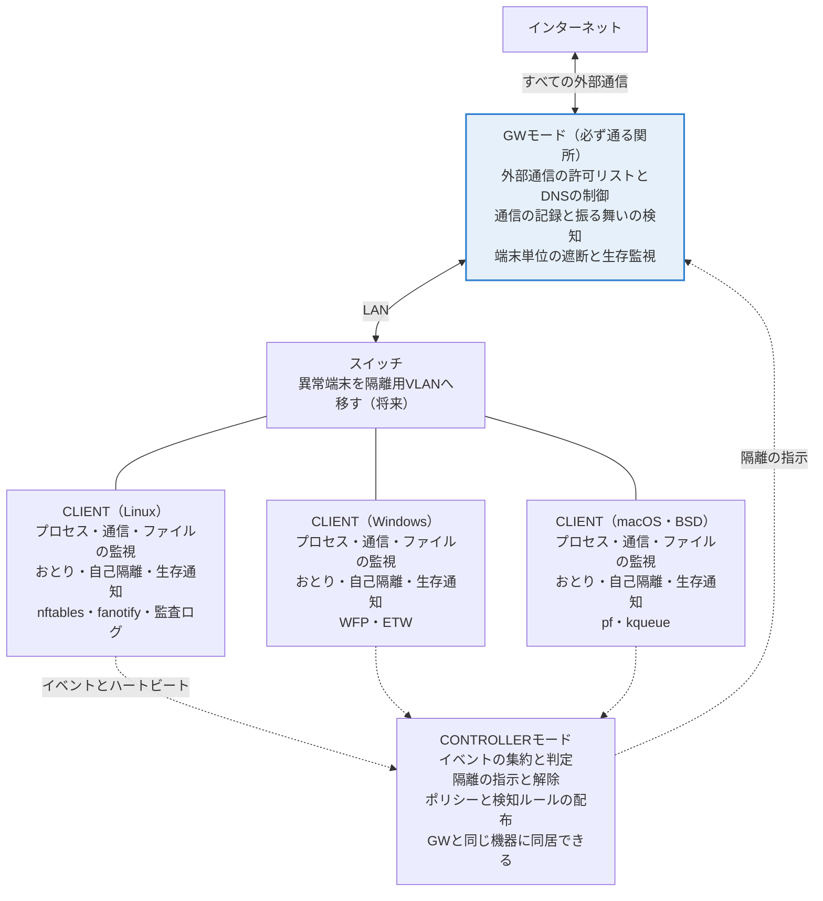
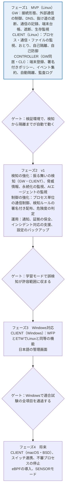

# AI攻撃対策 統合防御システム 機能要件（ドラフト）

2026-10-18

> この文書は `AI攻撃対策_統合防御システム_機能要件.docx`（削除済み）をMarkdownに変換したもので、以後はこちらを正本とする。図は差分を追えるようにMermaidで描き直した。開発の進め方と、要件への追加を検討している事項は [policy.md](policy.md) にまとめている。

## 前提とスコープ

AIを使う攻撃者を想定し、「検知・遮断・隔離」を1つの国産OSSで提供する。対象は当面、端末数十〜数百台の中小規模の組織、事業所、家庭とする（未決事項参照）。

- 言語と依存：Go。標準ライブラリと golang.org/x/ のみを使い、外部のOSSライブラリは使わない（脆弱性の修正を外部の対応待ちにしないため）
- OSとの連携：OS付属のコマンド（nft、pfctlなど、絶対パスで呼ぶ）か、システムコールの直接実装
- 対応OSの順序：Linux → Windows → macOS → FreeBSD / OpenBSD
- 国産OSSとしての要素：日本語の文書と画面、JPCERT/CCの注意喚起への対応、データを国外に送らない設計

設計の基本方針：

- 乗っ取られた端末の中だけで防御を完結させず、端末の外（GW、スイッチ）でも遮断する
- 通信先は「原則拒否・許可リスト」を選べるようにする
- 既知のシグネチャより振る舞いで検知する
- 検知から隔離までを自動化し、「監視→警告→遮断」と段階的に有効にできるようにする
- 防御システム自身が攻撃される前提で作る（署名、権限分離、停止されたら隔離）
- OSごとの差は対応機能（Capabilities）として申告し、共通部分を最大化する

## 想定する脅威

想定する攻撃は12種類で、AIによって主に「速さ」「規模」「巧妙さ」が増す。T12は技術的な対策が限られるため対象外とする。

| ID | 攻撃 | AIで変わること |
|---|---|---|
| T1 | フィッシングとなりすまし | 自然な日本語で個人に合わせた文面を大量生成し、認証情報やセッションを盗む |
| T2 | 公開された脆弱性の悪用 | 公表から悪用までが短くなる。VPN機器や公開サーバーが狙われる |
| T3 | 自動の偵察と横展開 | 内部のスキャン、パスワードの総当たりや使い回し、権限昇格を自律的に連続実行する |
| T4 | 正規ツールの悪用 | PowerShell、curl、ssh、rcloneなど正規ツールだけで攻撃し、マルウェアを使わない |
| T5 | 遠隔操作通信（C2）の隠蔽 | 正規のクラウドサービス、DNS over HTTPS、低頻度の通信に紛れる |
| T6 | データの持ち出し | クラウドストレージ、DNSトンネル、少量ずつの分割送信で目立たずに持ち出す |
| T7 | ランサムウェア | 短時間で大量のファイルを暗号化し、バックアップも壊す |
| T8 | 適応型・多形のマルウェア | 検知されるたびに書き換えられ、シグネチャでは捕まらない |
| T9 | 防御システム自体への攻撃 | エージェントの停止・改ざん、偽のポリシーの注入、更新経路の乗っ取り |
| T10 | 正規のAIエージェントの悪用 | プロンプトインジェクションで端末上のAIエージェントを操る、AIサービスのAPIキーを盗む |
| T11 | ソフトウェア供給網の攻撃 | 偽のパッケージや乗っ取られた更新から侵入する |
| T12 | ディープフェイクによる詐欺 | 本人そっくりの音声や映像で送金や認証を指示する（対象外） |

## システム構成とモード

構成はGW・CLIENT・CONTROLLERの3モードとする。ミラーポートで受動的に監視するSENSORモードは、追加の余地を残して未決とする。

3モードの構成。実線は通信の経路、破線は管理通信（相互TLS）、青枠は乗っ取られた端末から止められない要。

GWはすべての外部通信が通る位置に置き、CLIENTが停止されても生存監視と遮断で止める。CONTROLLERは小規模な環境ではGWと同じ機器で動かす。

## GWモードの機能

GWモードは「すべての通信が必ず通る関所」として、外部通信の制御、通信の記録と検知、端末単位の遮断を担う。乗っ取られた端末からは止められないことが最大の役割。

| ID | 機能 | 内容 | 優先度 |
|---|---|---|---|
| G1 | 接続形態 | ルーター（NAT）とブリッジ（透過）の2方式、IPv4とIPv6の両対応 | MVP |
| G2 | 外部通信の制御 | 宛先（ドメイン、IP、ポート）の許可・拒否リスト、端末グループ別のポリシー、学習モードと原則拒否モード | MVP |
| G3 | DNSの制御 | 内部リゾルバ、ブロックリスト、外部DNSへの直接問い合わせの遮断、問い合わせの記録 | MVP |
| G4 | 抜け道の遮断 | IPv6、QUIC（UDP 443）、既知のDoH/DoTの接続先、許可していないVPNやトンネル | MVP |
| G5 | 通信の記録 | フロー記録（送信元、宛先、量、時間）、TLSのSNIと指紋、平文HTTPのHost | MVP |
| G6 | 振る舞いの検知 | 周期的な通信（ビーコン）、大量送信、内部へのスキャン、新しい宛先の急増、時間外の通信 | v1 |
| G7 | 脅威情報の取り込み | 公開されている悪性ドメインやIPの一覧をデータとして取り込み、照合する | v1 |
| G8 | 端末の識別と台帳 | DHCPサーバー機能、ARP/NDの監視によるなりすまし検知、未登録端末の検知 | MVP |
| G9 | 端末単位の遮断 | 全遮断、管理通信のみ許可、更新サーバーも許可の3段階 | MVP |
| G10 | 生存監視 | CLIENTからの署名付きハートビートを監視し、途絶えたら自動で隔離する | MVP |
| G11 | スイッチ連携 | 異常な端末を隔離用VLANへ移し、LAN内の横展開を止める（802.1X、RADIUSなど） | 将来 |
| G12 | GW自身の保護 | 管理画面への接続制限、権限分離、設定の改ざん検知、障害時に遮断するか通すかの設定 | MVP |

G11が将来の間は、LAN内の横展開はCLIENT側の自己隔離（C6）で止める。

## CLIENTモードの機能

CLIENTモードは、暗号化の内側や端末内部の動きなど、GWから見えないものを検知する。管理者権限を奪われると停止され得る前提で、停止そのものをGWの生存監視（G10）で検知する。

| ID | 機能 | 内容 | 優先度 |
|---|---|---|---|
| C1 | プロセスの監視 | 起動・終了、親子関係、コマンドライン、実行ファイルのハッシュ | MVP |
| C2 | 通信の監視 | 接続ごとに発信元のプロセスを紐付ける（GWでは得られない情報） | MVP |
| C3 | ファイルの監視 | 認証情報、設定、自動起動など重要な場所の変更、短時間の大量変更 | MVP |
| C4 | 永続化と権限の監視 | 自動起動、cron、サービス、タスクの追加、ログオン、権限昇格、ドライバーやカーネルモジュールの読み込み | v1 |
| C5 | おとり（ハニートークン） | 偽の認証情報、SSH鍵、APIキー、文書を置き、触られたら高確度で警告する | MVP |
| C6 | 自己隔離 | ホストのファイアウォールで管理通信以外を遮断する。GWの遮断と二重化し、テザリングなど別回線も止める | MVP |
| C7 | プロセス単位の通信制御 | アプリごとの外部通信の許可・拒否。別回線でも適用する | v1 |
| C8 | 振る舞いの検知 | 正規ツールの不審な使い方、不審な親子関係、認証情報やブラウザのCookieへのアクセス、短時間に連続する列挙操作 | v1 |
| C9 | AIエージェントの監視 | 端末上のAIエージェントが実行するコマンドと通信先の可視化と制限、APIキーの保存場所の監視 | v1 |
| C10 | 自己防御 | 特権の執行部と非特権の解析部に分離、停止・改ざんの検知、署名付きハートビート | MVP |
| C11 | 証拠の保全 | 隔離時にプロセス一覧、接続、ログを自動で保存し、管理側へ送る | v1 |
| C12 | 対応機能の申告 | OSごとに使える機能（Capabilities）を管理側へ報告する | MVP |
| C13 | 不審プロセスの停止 | 管理側の承認または設定に応じてプロセスを止める | 将来 |

## CONTROLLER（管理機能）の機能

CONTROLLERはGWとCLIENTの情報をまとめて判断し、隔離やポリシーを指示する。小規模な環境ではGWと同じ機器で動かす。

| ID | 機能 | 内容 | 優先度 |
|---|---|---|---|
| M1 | 端末の登録 | 端末ごとに証明書を発行（相互TLS）、端末台帳、グループ分け | MVP |
| M2 | ポリシーの管理と配布 | 署名付きで配布、版の管理とロールバック、一部の端末から段階的に適用 | MVP |
| M3 | 検知ルールの管理 | 署名付きの更新、段階配布、誤検知の例外管理 | v1 |
| M4 | イベントの集約と相関 | GWとCLIENTのイベントを共通形式で集め、端末ごとに時系列で結び付ける | MVP |
| M5 | 判定と危険度 | 端末ごとの危険度を計算し、しきい値で自動対応を決める | v1 |
| M6 | 自動対応 | 隔離と解除の指示。重要な端末は人の承認を必須にできる | MVP |
| M7 | 通知 | メール、Webhook（Slackなど） | v1 |
| M8 | CLIと管理画面 | 日本語の画面、状態の表示、隔離操作。初版はCLI中心 | MVP |
| M9 | インシデント対応の支援 | 切り離し、保全、認証情報の変更、再インストールの手順、個人情報保護委員会への報告期限の管理、時系列の自動作成 | v1 |
| M10 | 監査ログ | 管理操作の記録。ハッシュの連鎖で改ざんを検知する | MVP |
| M11 | 設定のバックアップ | 設定とポリシーの書き出しと復元 | v1 |
| M12 | GWへの同居 | CONTROLLERをGWと同じ機器で動かせる | MVP |

## 共通基盤と非機能要件

全モードは1つのリポジトリで開発し、通信、データ形式、署名の仕組みを共有する。配布は1つの実行ファイルをモード指定で起動する形を案とする。

共通基盤

- 通信：相互TLS（crypto/tls）、内部の認証局、証明書の定期更新
- イベント形式：OCSFに準拠した共通形式（必要な範囲のみ）
- ポリシーと検知ルールの形式：JSON（標準ライブラリで扱える）
- 署名：リリース、ポリシー、検知ルールに署名し、検証してから適用する（crypto/ed25519）
- OSの抽象化：Platformインターフェース（対応機能の申告、イベント取得、通信制御、隔離、解除）
- ログの保存：容量の上限とローテーション
- 時刻：全モードで時刻同期を前提とし、相関分析の精度を保つ

非機能要件

- 性能：GWは対象回線の速度を落とさず処理し、CLIENTはCPUとメモリの使用量に上限を設ける（目標値は未決）
- 誤検知対策：学習モードで平常時を記録してから遮断を有効にする。例外の登録ができる
- 障害時の動作：遮断するか通すかを、モードと用途ごとに選べる
- 更新：Goのセキュリティリリースに追随して自動で再ビルドし、段階的に配布する

品質保証

- OSごとの適合試験をCIで実行する
- 入力を解析する部分にファジング（go test -fuzz）をかける
- govulncheck、再現可能なビルド（-trimpath）、SBOMの公開
- SECURITY.mdで脆弱性の受付窓口を示し、JPCERT/CCとの調整の流れに乗れるようにする

## 脅威と機能の対応表

T1〜T11は、いずれもGWとCLIENTの両方で対策があり、片方が破られてももう片方で止められる構成になっている。

| 脅威 | GWでの対策 | CLIENTでの対策 | CONTROLLERでの対策 |
|---|---|---|---|
| T1 フィッシング | G3、G7（偽サイトの遮断） | C5、C8（認証情報やCookieへのアクセス） | M5 |
| T2 公開脆弱性の悪用 | G2、G9（侵入後の外部通信を遮断） | C1、C4（不審な起動と永続化） | M6 |
| T3 偵察と横展開 | G6、G8（内部スキャン、なりすまし） | C5、C8（おとりへの接触、連続した列挙） | M4、M6（相関と即時隔離） |
| T4 正規ツールの悪用 | G2（未許可の宛先を遮断） | C1、C8（不審な使い方） | M4 |
| T5 C2の隠蔽 | G3、G4、G6（DoHの遮断、ビーコン検知） | C2（通信元プロセスの特定） | M4 |
| T6 データの持ち出し | G2、G5、G6（許可外の宛先、大量送信） | C2、C7 | M6 |
| T7 ランサムウェア | G9 | C3（短時間の大量変更）、C11 | M6、M9 |
| T8 適応型マルウェア | G6（振る舞いで検知） | C8 | M5 |
| T9 防御システムへの攻撃 | G10、G12 | C10 | M2、M3、M10（署名と監査） |
| T10 AIエージェントの悪用 | G2（エージェントの通信先を限定） | C9、C5（偽のAPIキー） | M6 |
| T11 供給網の攻撃 | G2（更新元を限定） | C1（ハッシュの照合） | M2（署名付き配布） |

T1の根本対策はパスキーなどフィッシングに強い認証への移行で、本システムは盗まれた後の悪用を止める役割を担う。

## 対象外とする範囲

次の6点は初版の対象外とし、他の手段で補うか将来検討とする。

- ディープフェイク詐欺（T12）：技術的な検知が難しい。折り返し確認や複数人の承認など業務手順で対策し、M9の手順書に指針を含める
- メール本文のフィルタリング：別製品の領域。DNSと宛先の制御で、開いた後の被害を抑える
- TLSの中身の復号検査：プライバシーと複雑さのため行わない。通信のメタデータとCLIENTで補う
- カーネルドライバー：障害時の影響が大きいため作らず、OS標準の仕組みだけを使う
- 攻撃コードの作成：試験には公開データセットと無害な再現ツールを使う
- 大規模環境向けの機能：多拠点、数千台規模、SIEMとの本格的な連携は将来検討とする

## 開発フェーズ案

開発は4段階で進め、各段階の終わりに次に進む条件（ゲート）を置く。日程は未定。

MVPはLinuxのGWとCLIENTで検知から隔離までを通す。フェーズ1は優先度MVPの機能、フェーズ2はv1の機能に対応する。

## 未決事項

次の9点は、MVPの設計を固める前に決める必要がある。

- 対象規模（端末台数の上限、家庭向けと事業所向けを分けるか）
- GWのハードウェア（小型PC、既存ルーターへの組み込み、仮想マシン）
- GWの既定の接続形態（ルーターかブリッジか）
- 学習モードの期間と、原則拒否モードへ移る条件
- 性能の目標値（GWの処理速度、CLIENTのCPUとメモリの上限）
- ライセンス（GPL系かApache系か、商用ライセンスとの両立）
- 実行ファイルを1つにまとめるか、モードごとに分けるか
- ミラーポートで受動的に監視するSENSORモードを設けるか
- プロジェクト名

各項目の現在の扱いは [policy.md](policy.md) の「未決事項の扱い」を参照。
